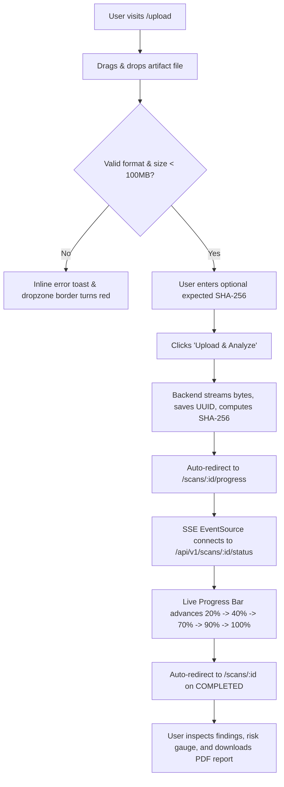
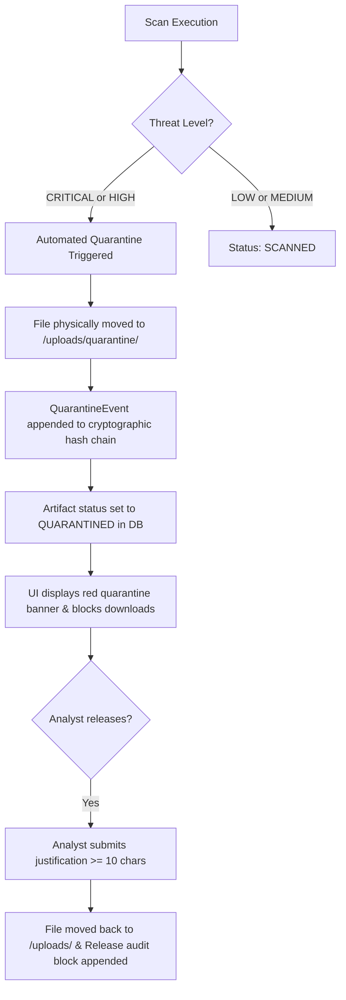
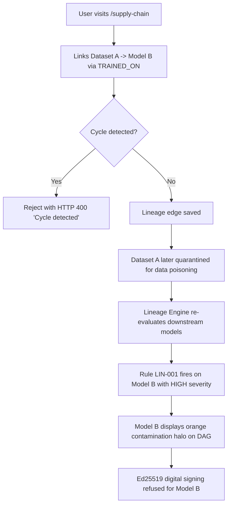

# UI/UX Specification & Design System Document

**Project:** AISecGuard — Automated Framework for Detecting, Preventing, and Mitigating AI Supply Chain Attacks  
**Document Identifier:** ASG-UIUX-V2.0  
**Version:** 2.0.0  
**Target Milestone:** Minimum Viable Product (MVP) & Research Phase 1  
**Status:** Approved / Implementation-Ready Baseline  
**Design Standard:** Modern Precision Cybersecurity (Glassmorphism, High Contrast, Real-Time Telemetry)  
**Author:** MCA 3rd Semester Project Team  

---

## 1. Executive Vision & Core Design Principles

### 1.1 Product UX Vision
AISecGuard is a mission-critical cybersecurity and governance interface tailored for Security Analysts, MLOps Engineers, Data Scientists, and AI Compliance Officers. The interface balances high-density technical diagnostic telemetry (raw opcode streams, statistical distributions, multi-hop lineage graphs) with rapid, low-friction decision-making. 

The primary UX objective is **zero alert fatigue through transparent, actionable explainability**: every risk score displays its mathematical derivation, and every vulnerability finding is paired with an immediate, copyable remediation directive.

### 1.2 Core Design Principles

```
┌────────────────────────────────────────────────────────────────────────┐
│                        CORE UX DESIGN PRINCIPLES                       │
├────────────────────────────────────────────────────────────────────────┤
│ 1. Clarity Over Cognitive Clutter : Progressive disclosure of data.    │
│ 2. Explainable Threat Telemetry   : Every score exposes its math.      │
│ 3. Immediate Actionability        : Every red finding includes a fix.  │
│ 4. Zero-Friction Live Telemetry   : Real-time Server-Sent Events (SSE).│
│ 5. Precision Cybersecurity Craft   : High-contrast, dark-mode first.    │
│ 6. Accessible by Default (WCAG AA): Color + icon + text indicators.    │
└────────────────────────────────────────────────────────────────────────┘
```

1. **Clarity Over Cognitive Clutter:** Complex machine learning internals (pickle opcodes, z-score matrices, dependency trees) are organized via progressive disclosure. Primary screens surface clear high-level risk classifications, while deep diagnostics expand on demand.
2. **Explainable Threat Telemetry:** Threat calculations are never opaque. The 0–10 risk score displays its exact points derivation, finding severity tallies, and deterministic rule triggers.
3. **Immediate Actionability:** Detection without remediation is incomplete. Every vulnerability finding is paired with prescriptive guidance (e.g., SafeTensors conversion script, pinned package version, or one-click quarantine).
4. **Zero-Friction Live Telemetry:** Replaces static spinners and manual polling with real-time HTML5 Server-Sent Events (SSE), streaming monotonic progress transitions (`QUEUED` $\rightarrow$ `PROVENANCE_CHECK` $\rightarrow$ `SCANNER_RUNNING` $\rightarrow$ `RISK_CALC` $\rightarrow$ `COMPLETED`).
5. **Precision Cybersecurity Craft:** A dark-mode-first aesthetic utilizing deep slate tones, frosted glassmorphic card overlays, crisp borders, and electric semantic accent colors.
6. **Accessible by Default (WCAG 2.1 AA):** High contrast ratios ($\ge 4.5:1$), full keyboard navigability with visible focus rings, non-color-dependent status badges, and ARIA live regions for streaming telemetry.

---

## 2. Design Tokens: Colors, Typography, Spacing & Elevation

The interface is built with **Tailwind CSS v4** using CSS custom properties declared in `frontend/src/index.css`.

### 2.1 Color Palette & Dual-Theme Tokens

The interface defaults to a dark cybersecurity operations theme with full light-mode capability:

```
┌────────────────────────────────────────────────────────────────────────┐
│                       SEMANTIC SEVERITY PALETTE                        │
├────────────────────────────────────────────────────────────────────────┤
│ • CRITICAL : #EF4444 (Red)    — RCE opcodes, backdoors, prompt attacks │
│ • HIGH     : #F97316 (Orange) — Upstream risk (LIN-001), hash mismatch │
│ • MEDIUM   : #F59E0B (Amber)  — Missing values >20%, unpinned packages │
│ • LOW      : #10B981 (Emerald)— Clean baseline, broad range warnings   │
│ • INFO     : #3B82F6 (Blue)   — Metadata recorded, format safe         │
└────────────────────────────────────────────────────────────────────────┘
```

#### Detailed Design Token Matrix:

| Token Name | Dark Mode Value (`[data-theme=dark]`) | Light Mode Value (`[data-theme=light]`) | Purpose & Semantic Role |
|---|---|---|---|
| `--color-bg` | `#0F172A` (Slate 900) | `#F8FAFC` (Slate 50) | Main application canvas. |
| `--color-bg-darker` | `#0B1120` (Slate 950) | `#EDF2F7` (Slate 100) | Sidebar, terminal logs, code blocks. |
| `--color-surface` | `#1E293B` (Slate 800) | `#FFFFFF` (White) | Modals, dropdown menus, cards. |
| `--color-surface-card` | `rgba(30, 41, 59, 0.7)` | `#FFFFFF` | Frosted cards (`backdrop-blur-md`). |
| `--color-border` | `#334155` (Slate 700) | `#E2E8F0` (Slate 200) | Primary structural borders. |
| `--color-border-subtle` | `rgba(51, 65, 85, 0.4)` | `#EDF2F7` | Inner table cell borders. |
| `--color-border-highlight`| `#3B82F6` (Blue 500) | `#2563EB` (Blue 600) | Active focus rings, selected tabs. |
| `--color-text` | `#F8FAFC` (Slate 50) | `#0F172A` (Slate 900) | Primary headings, body copy. |
| `--color-text-muted` | `#94A3B8` (Slate 400) | `#64748B` (Slate 500) | Secondary metadata, labels, hints. |
| `--color-primary` | `#3B82F6` (Blue 500) | `#2563EB` (Blue 600) | Primary CTAs, active links. |
| `--color-danger` | `#EF4444` (Red 500) | `#DC2626` (Red 600) | Quarantine actions, Critical findings. |
| `--color-warning` | `#F59E0B` (Amber 500) | `#D97706` (Amber 600) | Medium severity, review alerts. |
| `--color-success` | `#10B981` (Emerald 500) | `#059669` (Emerald 600) | Valid signatures, clean status. |
| `--color-cyan` | `#06B6D4` (Cyan 500) | `#0891B2` (Cyan 600) | Telemetry radar nodes, dataset badges. |
| `--color-purple` | `#8B5CF6` (Purple 500) | `#7C3AED` (Purple 600) | Dependency badges, ML-BOM tags. |

### 2.2 Typography Scale & Hierarchy

The typography pairs **Inter** for readable UI controls with **JetBrains Mono** for precision security data:

| Scale Role | Font Family | Size / Line Height | Weight | Tailwind Class | Usage Example |
|---|---|---|---|---|---|
| **Display / Hero** | `Inter`, sans-serif | 36px / 44px | SemiBold (600) | `text-4xl font-semibold` | Landing headline, score gauge number. |
| **Heading 1 (H1)** | `Inter`, sans-serif | 28px / 36px | SemiBold (600) | `text-2xl font-semibold` | Page titles (Dashboard, Scans, Quarantine).|
| **Heading 2 (H2)** | `Inter`, sans-serif | 20px / 28px | Medium (500) | `text-xl font-medium` | Section headers, card titles. |
| **Heading 3 (H3)** | `Inter`, sans-serif | 16px / 24px | Medium (500) | `text-base font-medium` | Finding item titles, table headers. |
| **Body (Default)** | `Inter`, sans-serif | 14px / 20px | Regular (400) | `text-sm font-normal` | Paragraph text, metadata, form labels. |
| **Microcopy** | `Inter`, sans-serif | 12px / 16px | Regular (400) | `text-xs font-normal` | Timestamps, secondary hints, table footnotes.|
| **Code / Technical** | `JetBrains Mono` | 13px / 18px | Regular (400) | `font-mono text-xs` | Hashes (SHA-256), opcodes, paths, CVE IDs.|

### 2.3 Spacing Grid & Container Bounds
- **Grid Baseline:** Standard 8-point spatial system ($4\text{px}, 8\text{px}, 12\text{px}, 16\text{px}, 24\text{px}, 32\text{px}, 48\text{px}, 64\text{px}$).
- **Container Max-Widths:**
  - `max-w-7xl` ($1280\text{px}$): Dashboard, Scans Inventory, Quarantine Center.
  - `max-w-4xl` ($896\text{px}$): Upload Hub, Scan Detail Inspection, Settings.
  - `w-full`: Interactive Lineage DAG canvas.
- **Section Padding:**
  - Desktop: `p-6 lg:p-8`
  - Mobile: `p-4`

### 2.4 Border Radii & Elevation
- **`rounded-md` ($6\text{px}$):** Badges, tag pills, inline code spans.
- **`rounded-lg` ($8\text{px}$):** Buttons, text inputs, select dropdowns.
- **`rounded-xl` ($12\text{px}$):** Standard dashboard cards, data tables, telemetry progress panels.
- **`rounded-2xl` ($16\text{px}$):** Modal dialogs, hero terminal console.
- **Elevation / Shadows:**
  - Cards: `shadow-sm`, subtle border glow (`shadow-blue-500/5`).
  - Active Modals: `shadow-2xl` with `backdrop-blur-sm`.

---

## 3. User Journeys & Target Personas

```
┌────────────────────────────────────────────────────────────────────────┐
│                        TARGET USER PERSONAS                            │
├────────────────────────────────────────────────────────────────────────┤
│ 1. MLOps Engineer (Alex)     : Automates pre-deployment gating in CI/CD│
│ 2. AppSec Analyst (Maya)     : Investigates RCE payloads & quarantines │
│ 3. Data Scientist (Kiran)    : Ensures training datasets lack poisons  │
│ 4. Compliance Officer (Elena): Generates ML-BOM & EU AI Act evidence   │
└────────────────────────────────────────────────────────────────────────┘
```

### 3.1 Persona 1: MLOps Engineer (Alex)
* **Goal:** Verify third-party model checkpoints (`.safetensors`, `.pt`) from Hugging Face before deploying to production serving clusters.
* **Journey Flow:**
  1. Alex logs into the dashboard or uses the API key via CI/CD.
  2. Navigates to `/upload`, drops `vision_model.pt`, and enters the Hugging Face expected SHA-256 hash.
  3. Watches live SSE telemetry transition from 20% to 100% without refreshing.
  4. Observes 0 critical findings and a 0.0 LOW risk score.
  5. Clicks "Sign Model" to generate an Ed25519 digital signature, allowing the deployment pipeline to pull the model.

### 3.2 Persona 2: AppSec Analyst (Maya)
* **Goal:** Audit untrusted model uploads from unknown vendors and mitigate malicious code execution threats.
* **Journey Flow:**
  1. Maya opens `/scans` and filters by `CRITICAL` severity.
  2. Clicks on a flagged scan for `classifier_v2.pkl`.
  3. Inspects the circular risk gauge (Score 10 - CRITICAL) and reviews finding `PICKLE-001`.
  4. Reads the exact opcode offset pointing to `GLOBAL 'os' 'system'` and the payload string `rm -rf /`.
  5. Clicks "Quarantine Artifact", enters the required release authorization note, and confirms physical isolation to `/uploads/quarantine/`.
  6. Exports the ReportLab PDF executive remediation report to attach to the incident ticket.

### 3.3 Persona 3: Data Scientist (Kiran)
* **Goal:** Validate training dataset integrity and ensure no label skew or data poisoning anomalies exist before launching training runs.
* **Journey Flow:**
  1. Kiran uploads `customer_churn_train.csv` to `/upload`.
  2. Reviews the scan details: finds 1 `MEDIUM` alert for high missing values in column `account_age` ($24\%$) and extreme z-score outliers in `balance` ($|z| = 5.4$).
  3. Reviews the remediation guidance detailing outlier clipping and data imputation steps.
  4. Links the dataset to the base model in `/supply-chain` via `TRAINED_ON`.

### 3.4 Persona 4: AI Compliance & Risk Officer (Elena)
* **Goal:** Verify compliance with the EU AI Act (Regulation 2024/1689) and supply machine-readable ML-BOMs to external auditors.
* **Journey Flow:**
  1. Elena navigates to `/supply-chain` and selects the production model.
  2. Inspects the visual multi-hop lineage DAG showing upstream datasets and packages.
  3. Opens the **EU AI Act Compliance** tab: reviews status ratings (`MET` for Articles 10, 11, 12, 14, 15).
  4. Clicks "Export CycloneDX 1.6 ML-BOM" to download the structured JSON asset inventory.
  5. Navigates to `/quarantine` and clicks "Verify Audit Chain" to confirm that all historical quarantine events are cryptographically intact.

---

## 4. Information Architecture & Navigation

The application uses an accessible **Persistent App Shell** layout (`Layout.jsx`):

```
┌────────────────────────────────────────────────────────────────────────────────────────┐
│ TOP BAR: Logo • Mode Badge (Standalone/Enterprise) • Quick Scan CTA • Theme • Profile  │
├─────────────────────┬──────────────────────────────────────────────────────────────────┤
│ SIDEBAR NAVIGATION  │ MAIN CONTENT VIEWPORT                                            │
│ • Dashboard         │ (Dynamic Route Content with Smooth Page Transitions)             │
│ • Upload Artifact   │                                                                  │
│ • Scan History      │                                                                  │
│ • Lineage Graph     │                                                                  │
│ • Quarantine Center │                                                                  │
│ • Settings & API Key│                                                                  │
│                     │                                                                  │
│ [Collapse Toggle]   │                                                                  │
├─────────────────────┴──────────────────────────────────────────────────────────────────┤
│ TOAST NOTIFICATION CONTAINER (Bottom-Right Floating Portal)                            │
└────────────────────────────────────────────────────────────────────────────────────────┘
```

### 4.1 Primary Navigation Items

| Navigation Item | Route | Lucide Icon | Description |
|---|---|---|---|
| **Dashboard** | `/dashboard` | `LayoutDashboard` | High-level threat posture, metrics, recent scans. |
| **Upload & Scan** | `/upload` | `UploadCloud` | Drag-and-drop artifact ingestion portal. |
| **Scan History** | `/scans` | `ShieldCheck` | Paginated, filterable scan inventory. |
| **Supply Chain** | `/supply-chain` | `GitFork` | Interactive multi-hop lineage DAG & compliance evidence. |
| **Quarantine** | `/quarantine` | `AlertOctagon` | Isolated artifacts, release approvals, audit chain. |
| **Settings** | `/settings` | `Settings` | Developer API keys, profile, system diagnostics. |

---

## 5. Comprehensive Screen Specifications & Wireframe Layouts

### 5.1 Screen 1: Public Landing Page (`/`)
* **Purpose:** Educates visitors, demonstrates zero-execution security, and offers an instant sandbox tester.
* **Layout Structure:**
  1. **Top Navigation (`HomeNav.jsx`):** Brand logo, direct navigation anchor links (Pipeline, Interactive Console, FAQ), and "Launch Dashboard" button.
  2. **Hero Section (`hero.png` & `HeroNetworkVisual.jsx`):** High-impact cyber-mesh network graphic with primary value proposition and "Start Free Inspection" CTA.
  3. **Live Sandbox Console (`HeroScanConsole.jsx`):** Interactive terminal widget allowing prospective users to test pre-loaded sample model files (`safe_model.safetensors` vs. `malicious_pickle.pkl`) without logging in.
  4. **4-Stage Pipeline Flow (`PipelineFlow.jsx`):** Visual interactive walkthrough of Ingestion $\rightarrow$ Static Disassembly $\rightarrow$ Lineage Risk $\rightarrow$ Quarantine.
  5. **Interactive Risk Calculator (`RiskCalculator.jsx`):** Interactive widget demonstrating how points map to the 0–10 risk engine.
  6. **Technical FAQ (`Faq.jsx`):** Answers core architectural questions regarding zero-code-execution safety and format support.

### 5.2 Screen 2: Security Dashboard (`/dashboard`)
* **Purpose:** Centralized Security Operations Center (SOC) operational overview.
* **Layout Structure:**

```
┌────────────────────────────────────────────────────────────────────────┐
│  4 Top KPI Cards                                                       │
│  ┌──────────────┐  ┌──────────────┐  ┌──────────────┐  ┌─────────────┐ │
│  │ Total Scans  │  │ Crit Threats │  │ Quarantined  │  │Signed Models│ │
│  │ 128 (+12)    │  │ 4 (Action)   │  │ 3 Files      │  │ 84 (Clean)  │ │
│  └──────────────┘  └──────────────┘  └──────────────┘  └─────────────┘ │
├──────────────────────────────────────┬─────────────────────────────────┤
│  Risk Distribution Donut Chart       │  14-Day Scan Velocity Trendline │
│  [ CRITICAL: 4 | HIGH: 8 | MED: 16 ] │  [ Daily Volume Line Chart ]    │
├──────────────────────────────────────┴─────────────────────────────────┤
│  Recent Activity Table (Top 10 Scans)                                  │
│  Filename         Type       SHA-256 (Truncated)   Severity    Action  │
│  model_v2.pkl     MODEL      7f83b165...           CRITICAL    [View]  │
│  data_train.csv   DATASET    3a12c890...           LOW         [View]  │
└────────────────────────────────────────────────────────────────────────┘
```

### 5.3 Screen 3: Artifact Upload & Intake Hub (`/upload`)
* **Purpose:** Frictionless ingestion of AI models, datasets, and manifests.
* **Layout Structure:**

```
┌────────────────────────────────────────────────────────────────────────┐
│  Upload AI Supply Chain Artifact                                       │
│  Select Artifact Category: [ Model (.pkl, .pt, .safetensors) ]         │
│                            [ Dataset (.csv, .parquet, .json) ]         │
│                            [ Dependency (requirements.txt, toml) ]     │
├────────────────────────────────────────────────────────────────────────┤
│  ┌ - - - - - - - - - - - - - - - - - - - - - - - - - - - - - - - - - ┐ │
│  │                     [ UploadCloud Icon ]                          │ │
│  │        Drag and drop your artifact file here, or browse           │ │
│  │     Supported: .pkl, .pt, .safetensors, .onnx, .csv, .txt         │ │
│  │                     Maximum size: 100 MB                          │ │
│  └ - - - - - - - - - - - - - - - - - - - - - - - - - - - - - - - - - ┘ │
├────────────────────────────────────────────────────────────────────────┤
│  Optional Security Provenance Inputs:                                  │
│  Expected SHA-256 Digest: [ 64-char hex string                  ] [OK] │
│  Upstream Source URL:     [ https://huggingface.co/...          ]      │
├────────────────────────────────────────────────────────────────────────┤
│  [ Upload & Analyze Artifact ]                                         │
└────────────────────────────────────────────────────────────────────────┘
```

### 5.4 Screen 4: Real-Time Scan Telemetry (`/scans/:scanId/progress`)
* **Purpose:** Transparent, real-time visualization of scanning pipeline stages via Server-Sent Events (SSE).
* **Layout Structure:**

```
┌────────────────────────────────────────────────────────────────────────┐
│  Scanning: resnet50_weights.pkl                                        │
│  Overall Progress: [============================== 70% ]               │
├────────────────────────────────────────────────────────────────────────┤
│  Pipeline Telemetry Radar:                                             │
│  (✓) QUEUED  ───> (✓) PROVENANCE  ───> (*) SCANNING  ───> ( ) RISK     │
│      20%                 40%                70% (Active)      90%      │
├────────────────────────────────────────────────────────────────────────┤
│  Live Diagnostic Terminal Output:                                      │
│  ┌──────────────────────────────────────────────────────────────────┐  │
│  │ [22:10:14] INFO: Artifact verified in storage (/uploads/uuid.pkl) │  │
│  │ [22:10:15] INFO: SHA-256 computed: 7f83b1657ff1fc53b92dc1814...  │  │
│  │ [22:10:16] SCAN: Disassembling raw pickle bytecode stream...     │  │
│  │ [22:10:17] ALERT: Intercepted opcode GLOBAL 'os' 'system'        │  │
│  └──────────────────────────────────────────────────────────────────┘  │
└────────────────────────────────────────────────────────────────────────┘
```

### 5.5 Screen 5: Scan Details & Findings Inspection (`/scans/:scanId`)
* **Purpose:** Deep diagnostic breakdown of vulnerabilities with actionable remediation guidance.
* **Layout Structure:**

```
┌────────────────────────────────────────────────────────────────────────┐
│  Scan Details: resnet50_weights.pkl                                    │
│  ┌───────────────────────┬───────────────────────────────────────────┐ │
│  │   [ 10 / 10 Gauge ]   │ Filename: resnet50_weights.pkl            │ │
│  │      CRITICAL         │ SHA-256: 7f83b165... [Copy Button]        │ │
│  │ 2 Critical Findings   │ Size: 48.2 MB | Ingested: 2 mins ago      │ │
│  └───────────────────────┴───────────────────────────────────────────┘ │
├────────────────────────────────────────────────────────────────────────┤
│  Action Bar: [Download PDF] [Export JSON] [Sign Model] [Quarantine]    │
├────────────────────────────────────────────────────────────────────────┤
│  Security Findings Breakdown (2):                                      │
│  ┌──────────────────────────────────────────────────────────────────┐  │
│  │ [CRITICAL] PICKLE-001: Unsafe Deserialization Opcode Detected    │  │
│  │ ---------------------------------------------------------------- │  │
│  │ Description: The model checkpoint contains an executable opcode   │  │
│  │ attempting to import and invoke 'os.system'.                     │  │
│  │ Exact Offset: Byte 0x000412 | Offending Symbol: posix.system     │  │
│  │                                                                  │  │
│  │ Remediation Code:                                                │  │
│  │   # Convert legacy pickle weights to safe SafeTensors format:    │  │
│  │   from safetensors.torch import save_file                        │  │
│  │   save_file(model.state_dict(), "model.safetensors")             │  │
│  └──────────────────────────────────────────────────────────────────┘  │
└────────────────────────────────────────────────────────────────────────┘
```

### 5.6 Screen 6: Quarantine Containment Center (`/quarantine`)
* **Purpose:** Management of physically isolated artifacts and review of tamper-evident audit logs.
* **Layout Structure:**

```
┌────────────────────────────────────────────────────────────────────────┐
│  Quarantine Containment Management                                     │
│  Storage Partition: /app/uploads/quarantine/ (Isolated)                │
├────────────────────────────────────────────────────────────────────────┤
│  Quarantined Inventory:                                                │
│  Artifact Name       Quarantined At        Reason             Action   │
│  malicious_net.pkl   2026-11-11 20:14     CRITICAL RCE payload [Release]│
├────────────────────────────────────────────────────────────────────────┤
│  Cryptographic Audit Hash Chain Status: [ VERIFIED INTACT (12 Events) ]│
│  Chain Verification Endpoint: /api/v1/audit/verify                     │
│  Block #12: Hash 3a4f... | Parent: 8d1e... | Action: QUARANTINED       │
│  Block #11: Hash 8d1e... | Parent: 0000... | Action: QUARANTINED       │
└────────────────────────────────────────────────────────────────────────┘
```

### 5.7 Screen 7: Supply Chain & Lineage Hub (`/supply-chain`)
* **Purpose:** Interactive exploration of multi-hop supply chain relations and compliance evidence.
* **Layout Structure:**

```
┌────────────────────────────────────────────────────────────────────────┐
│  Supply Chain Lineage Graph (DAG)                                      │
│  [Zoom In] [Zoom Out] [Reset View] [ + Link New Edge ]                 │
├────────────────────────────────────────────────────────────────────────┤
│  Interactive DAG Canvas:                                               │
│                                                                        │
│   ┌────────────────────┐   TRAINED_ON   ┌────────────────────┐         │
│   │ raw_dataset.csv    │───────────────>│ base_model.pt      │         │
│   │ [DATASET: CLEAN]   │                │ [MODEL: CLEAN]     │         │
│   └────────────────────┘                └─────────┬──────────┘         │
│                                                   │ FINE_TUNED_FROM    │
│   ┌────────────────────┐   DEPENDS_ON             ▼                    │
│   │ requirements.txt   │───────────────>┌────────────────────┐         │
│   │ [DEP: 1 VULNERABLE]│                │ production_net.pt  │         │
│   └────────────────────┘                │ [MODEL: LIN-001 !] │         │
│                                         └────────────────────┘         │
├────────────────────────────────────────────────────────────────────────┤
│  Tabs: [ EU AI Act Compliance Mapping ] [ CycloneDX 1.6 ML-BOM JSON ]  │
│  Article 10 (Data Governance):     [ MET ] - Anomaly scan passed.      │
│  Article 15 (Cybersecurity):       [ MET ] - Static opcode verified.   │
└────────────────────────────────────────────────────────────────────────┘
```

### 5.8 Screen 8: Settings & Developer API Keys (`/settings`)
* **Purpose:** System diagnostics and headless CI/CD credential generation.
* **Layout Structure:**

```
┌────────────────────────────────────────────────────────────────────────┐
│  Settings & Integrations                                               │
├────────────────────────────────────────────────────────────────────────┤
│  Developer API Keys (Headless CI/CD Pipeline Gating):                  │
│  [ + Generate New Key ]                                                │
│                                                                        │
│  Key Name         Prefix         Created          Last Used   Action   │
│  GitHub Actions   asg_7f83...    2026-11-01       1 hour ago  [Revoke] │
│  GitLab Runner    asg_12c9...    2026-11-08       Yesterday   [Revoke] │
├────────────────────────────────────────────────────────────────────────┤
│  System Diagnostics:                                                   │
│  • AISecGuard Core: v0.1.0 (Python 3.12 / FastAPI)                     │
│  • Active Scanners: ModelScanner, DatasetScanner, DependencyScanner    │
│  • Ed25519 Signing Key: Active (/uploads/.keys/signing_ed25519.pem)    │
│  • OSV Vulnerability Lookup: Enabled (osv.dev online)                  │
└────────────────────────────────────────────────────────────────────────┘
```

---

## 6. Primary User Flows (Logic & Transitions)

### 6.1 Flow 1: Artifact Intake, Scanning & Remediation Review


### 6.2 Flow 2: Automated Quarantine & Containment


### 6.3 Flow 3: Multi-Hop Lineage Risk Cascading (Rule LIN-001)


---

## 7. Component Library & Implementation Specifications

All components use **React 19** functional components styled via **Tailwind CSS v4**.

### 7.1 Buttons (`ui.jsx`)
```jsx
// Primary Action Button
export function PrimaryButton({ children, onClick, disabled, loading }) {
  return (
    <button
      onClick={onClick}
      disabled={disabled || loading}
      className="inline-flex items-center justify-center px-4 py-2.5 rounded-lg text-sm font-medium
                 bg-blue-600 hover:bg-blue-500 active:bg-blue-700 text-white shadow-sm
                 transition-colors duration-150 ease-in-out disabled:opacity-50 disabled:cursor-not-allowed
                 focus-visible:outline-none focus-visible:ring-2 focus-visible:ring-blue-500 focus-visible:ring-offset-2"
    >
      {loading && <SpinnerIcon className="w-4 h-4 mr-2 animate-spin" />}
      {children}
    </button>
  );
}

// Danger / Quarantine Button
export function DangerButton({ children, onClick, disabled }) {
  return (
    <button
      onClick={onClick}
      disabled={disabled}
      className="inline-flex items-center justify-center px-4 py-2 rounded-lg text-sm font-medium
                 bg-red-600 hover:bg-red-500 active:bg-red-700 text-white shadow-sm
                 transition-colors duration-150 ease-in-out disabled:opacity-50"
    >
      {children}
    </button>
  );
}
```

### 7.2 Severity Badges (`tokens.js`)
```jsx
export function SeverityBadge({ severity }) {
  const styles = {
    CRITICAL: 'text-red-400 bg-red-500/10 border-red-500/30',
    HIGH:     'text-orange-400 bg-orange-500/10 border-orange-500/30',
    MEDIUM:   'text-amber-400 bg-amber-500/10 border-amber-500/30',
    LOW:      'text-emerald-400 bg-emerald-500/10 border-emerald-500/30',
    INFORMATIONAL: 'text-blue-400 bg-blue-500/10 border-blue-500/30',
  };
  return (
    <span className={`inline-flex items-center px-2.5 py-0.5 rounded-full text-xs font-medium border ${styles[severity] || styles.INFORMATIONAL}`}>
      {severity}
    </span>
  );
}
```

### 7.3 Circular Risk Gauge
```jsx
export function CircularRiskGauge({ score, maxScore = 10 }) {
  const percentage = Math.min(100, Math.round((score / maxScore) * 100));
  const strokeColor = score >= 8 ? '#EF4444' : score >= 5 ? '#F59E0B' : '#10B981';
  return (
    <div className="relative w-28 h-28 flex items-center justify-center">
      <svg className="w-full h-full transform -rotate-90" viewBox="0 0 36 36">
        <path
          className="text-slate-800"
          strokeWidth="3.5"
          stroke="currentColor"
          fill="none"
          d="M18 2.0845 a 15.9155 15.9155 0 0 1 0 31.831 a 15.9155 15.9155 0 0 1 0 -31.831"
        />
        <path
          stroke={strokeColor}
          strokeWidth="3.5"
          strokeDasharray={`${percentage}, 100`}
          strokeLinecap="round"
          fill="none"
          d="M18 2.0845 a 15.9155 15.9155 0 0 1 0 31.831 a 15.9155 15.9155 0 0 1 0 -31.831"
        />
      </svg>
      <div className="absolute flex flex-col items-center">
        <span className="text-2xl font-bold font-mono text-slate-100">{score.toFixed(1)}</span>
        <span className="text-[10px] text-slate-400 uppercase tracking-wider">Risk Score</span>
      </div>
    </div>
  );
}
```

### 7.4 Accessible Modal Dialog
```jsx
export function Modal({ isOpen, onClose, title, children }) {
  if (!isOpen) return null;
  return (
    <div className="fixed inset-0 z-50 flex items-center justify-center p-4 bg-slate-950/75 backdrop-blur-sm" role="dialog" aria-modal="true">
      <div className="bg-slate-900 border border-slate-800 rounded-2xl max-w-lg w-full p-6 shadow-2xl relative">
        <div className="flex items-center justify-between pb-4 border-b border-slate-800">
          <h3 className="text-lg font-semibold text-slate-100">{title}</h3>
          <button onClick={onClose} className="text-slate-400 hover:text-slate-200" aria-label="Close dialog">
            <XIcon className="w-5 h-5" />
          </button>
        </div>
        <div className="py-4">{children}</div>
      </div>
    </div>
  );
}
```

---

## 8. Forms & Micro-Interactions

| Form Type | Inputs & Field Types | Validation Constraints | Inline Feedback Behavior |
|---|---|---|---|
| **Artifact Upload** | File (`dropzone`), Category (`tabs`), `expected_sha256` (`text`), `source_url` (`text`). | File $\le 100$ MB, extension must match category, SHA-256 must match `^[0-9a-f]{64}$`. | Green checkmark when SHA-256 reaches 64 characters; red border on oversize drop. |
| **Quarantine Release** | Justification `reason` (`textarea`), Confirmation `checkbox`. | Reason $\ge 10$ characters, checkbox must be checked. | Live character counter (`8/10`); submit disabled until conditions met. |
| **API Key Creation** | `name` (`text`, e.g. "GitHub Actions"). | Name 3–50 alphanumeric characters. | Single-view reveal modal displaying generated `asg_...` key with copy button. |
| **Lineage Edge Link** | `parent_id` (`select`), `child_id` (`select`), `relation` (`select`), `note` (`text`). | Parent $\ne$ Child, no cyclic loops permitted. | Live warning if cyclic connection is attempted. |

---

## 9. Comprehensive State Handling: Loading, Error & Empty

### 9.1 Loading States
- **Card Skeletons:** Animated pulse blocks (`animate-pulse bg-slate-800/60 rounded-lg h-32 w-full`) prevent layout shifts while metrics are fetching.
- **Table Row Skeletons:** 5 rows of shimmering lines rendered before scan history resolves.
- **SSE Telemetry:** Step-by-step radar node with animated glowing ring (`ring-4 ring-cyan-500/20`) indicates active background scanner phase.

### 9.2 Error States
- **Non-Blocking Toasts (`ToastContext.jsx`):** Emits floating alerts (Success, Error, Warning, Info) with slide-in animation and 5-second auto-eviction.
- **Application Crash Fallback (`ErrorBoundary.jsx`):** Traps unhandled runtime errors, displaying a recovery screen with error stack preview and "Reload Page" button.

### 9.3 Empty States
When a dataset, table, or search yields zero results:
- Centered iconography (`FolderOpen` or `ShieldCheck`).
- Clear heading: *"No scans found"*.
- Contextual guidance: *"Upload your first model or dataset to run an automated security assessment."*
- Primary CTA button: *"Upload Artifact"*.

---

## 10. Responsive Behavior & Breakpoints

| Breakpoint | Window Width | Navigation Presentation | Layout Adaptations |
|---|---|---|---|
| **Mobile (`< sm`)** | $< 640\text{px}$ | Sidebar transforms into slide-out off-canvas drawer with hamburger toggle. | 1-column layout; KPI cards stack vertically; data tables horizontally scroll. |
| **Tablet (`sm - md`)**| $640\text{px} - 768\text{px}$ | Sidebar collapses to compact icon-only rail. | 2-column KPI grid; tables switch to compact card cards. |
| **Laptop (`md - lg`)**| $768\text{px} - 1024\text{px}$ | Standard sidebar with tooltips. | 2-column KPI grid; split-pane findings view. |
| **Desktop (`> lg`)** | $\ge 1024\text{px}$ | Full persistent expanded sidebar navigation. | 4-column KPI grid; full side-by-side findings and remediation panels. |

---

## 11. Accessibility Specifications (WCAG 2.1 AA)

1. **Color Contrast Compliance:** All normal body copy maintains $\ge 4.5:1$ contrast against the slate background. Display headings maintain $\ge 3:1$.
2. **Multi-Channel Information Encoding:** Threat severity is never communicated by color alone. Badges combine color, explicit text labels (`CRITICAL`, `HIGH`), and distinct icons (`AlertOctagon`, `AlertTriangle`, `CheckCircle`).
3. **Keyboard Navigability:** Full logical tab traversal (`Tab` / `Shift+Tab`); all interactive elements feature visible focus rings (`focus-visible:ring-2 focus-visible:ring-blue-500 focus-visible:outline-none`). Modals trap focus and dismiss on `Escape`.
4. **Screen Reader Semantics:**
   - Real-time SSE progress updates use `aria-live="polite"` to inform screen readers of stage transitions.
   - Toast notifications use `role="status"` and `aria-atomic="true"`.
   - Icon buttons feature explicit `aria-label` attributes (e.g., `aria-label="Copy SHA-256 digest"`).

---

*Document maintained under the AISecGuard Framework Project Repository.*

