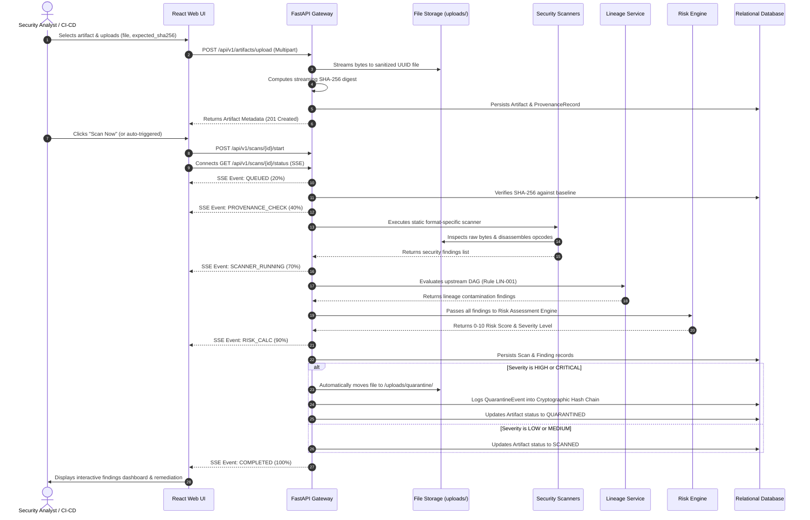

# System Architecture Document (SAD)

**Project:** AISecGuard — Automated Framework for Detecting, Preventing, and Mitigating AI Supply Chain Attacks  
**Document Identifier:** ASG-SAD-V1.0  
**Version:** 1.0.0  
**Status:** Approved / Engineering Baseline  
**Architecture Style:** Layered Modular Monolith (Pragmatic, Zero-Over-Engineering)  
**Target Milestone:** Minimum Viable Product (MVP) & Research Phase 1  
**Author:** MCA 3rd Semester Project Team  

---

## 1. Architectural Vision & Design Principles

### 1.1 Core Mission
AISecGuard is designed as an automated, pre-deployment security inspection gateway that verifies the provenance, integrity, serialization safety, dependency hygiene, and regulatory compliance of AI/ML artifacts before they reach operational environments.

### 1.2 Guiding Architectural Principles

```
┌────────────────────────────────────────────────────────────────────────┐
│                     CORE ARCHITECTURAL PRINCIPLES                      │
├────────────────────────────────────────────────────────────────────────┤
│ 1. Zero-Code-Execution Guarantee  : Files are NEVER loaded or run.     │
│ 2. Modular Monolith Design        : Clean separation without micro-    │
│                                     service operational overhead.      │
│ 3. Dual-Mode Deployment           : Zero-DB standalone mode for dev;   │
│                                     PostgreSQL for enterprise audit.   │
│ 4. Defense-in-Depth Containment   : Automatic physical isolation of    │
│                                     hazardous files via quarantine.    │
│ 5. Practicality Over Complexity   : Standard Python/React stack; no    │
│                                     unnecessary distributed queues.    │
└────────────────────────────────────────────────────────────────────────┘
```

1. **Zero-Code-Execution (Static Analysis Guarantee):** The backend never imports, unpickles, instantiates, or executes untrusted code. All analysis is driven by pure bytecode disassembly, token walking, and statistical mathematics.
2. **Modular Monolith Architecture:** Rather than introducing unnecessary distributed microservices, service meshes, or messaging brokers that add extreme latency and operational friction, AISecGuard employs a cohesive, layered modular monolith. Modules communicate via clear internal Python service interfaces.
3. **Dual-Mode Deployment:** The system supports a zero-dependency Standalone Mode (in-memory SQLite + local device cache) for rapid local evaluation, and an Enterprise Mode backed by PostgreSQL and JWT/API-key security.
4. **Deterministic & Explainable Outputs:** Risk calculations use explicit mathematical scoring without black-box opacity.

---

## 2. Recommended Technology Stack

The technology stack is carefully selected to maximize developer velocity, execution performance, security assurance, and portability across Linux, macOS, and Windows.

| Architectural Layer | Selected Technology | Version | Architectural Justification |
|---|---|---|---|
| **Frontend Framework** | **React SPA** | 19.x | Modern UI library with concurrent rendering; provides reactive dashboard state. |
| **Frontend Tooling** | **Vite** | 6.x | Instant HMR dev server and optimized production ES modules bundler. |
| **Styling & Icons** | **Tailwind CSS + Lucide** | v4.x / Latest | Utility-first CSS engine with zero runtime overhead; consistent design system. |
| **Backend Framework** | **Python + FastAPI** | 3.12 / 0.110+ | High-performance asynchronous REST API built on Starlette and Pydantic v2. |
| **ASGI Web Server** | **Uvicorn** | 0.27+ | High-throughput async web server running the Python ASGI standard. |
| **Data Validation** | **Pydantic** | v2.x | Ultra-fast C-extension (Rust-backed) schema validation and serialization. |
| **Relational ORM** | **SQLAlchemy** | 2.0+ | Modern type-safe ORM supporting both SQLite and PostgreSQL. |
| **Database Migrations**| **Alembic** | 1.13+ | Deterministic database schema version control. |
| **Persistence (Dev)** | **SQLite** | Built-in | Zero-configuration file or in-memory persistence for Standalone Mode. |
| **Persistence (Prod)**| **PostgreSQL** | 15-alpine | ACID-compliant enterprise storage with JSONB support and robust indexing. |
| **Cryptography** | **PyCA Cryptography** | 42.x+ | Industry-standard implementation for Ed25519 digital signing and SHA-256. |
| **Auth & Security** | **PyJWT + Passlib** | 2.8+ / 1.7+ | Stateless HS256 JWT tokens and salted bcrypt password hashing (12 rounds). |
| **Data Analytics** | **Pandas, NumPy, SciPy**| Latest | High-speed vectorized statistical computation for dataset anomaly scoring. |
| **Report Generation** | **ReportLab** | 4.x / 5.x | Native Python PDF rendering engine for publication-quality remediation reports. |
| **Containerization** | **Docker & Docker Compose**| Engine 24+ | Multi-stage reproducible builds and unified single-port deployment. |

---

## 3. High-Level System Architecture

```
                          USER / SECURITY ANALYST / CI-CD PIPELINE
                                             │
                                             ▼
┌────────────────────────────────────────────────────────────────────────────────────────┐
│                                PRESENTATION LAYER                                      │
│  React 19 SPA • Vite 6 • Tailwind CSS v4 • Lucide Icons • HTML5 Server-Sent Events     │
│  ┌──────────────────────┬──────────────────────┬──────────────────────┐                │
│  │ Dashboard & Stats    │ Artifact Upload Hub  │ Scan Telemetry (SSE) │                │
│  ├──────────────────────┼──────────────────────┼──────────────────────┤                │
│  │ Scan Details & Findings│ Lineage Graph (DAG)│ Quarantine Management│                │
│  └──────────────────────┴──────────────────────┴──────────────────────┘                │
└────────────────────────────────────────────┬───────────────────────────────────────────┘
                                             │ HTTP REST / Multipart / SSE (Port 8000)
                                             ▼
┌────────────────────────────────────────────────────────────────────────────────────────┐
│                               GATEWAY & SECURITY LAYER                                 │
│  FastAPI Application • SlowAPI Rate Limiter • CORS Middleware • Exception Handlers      │
│  ┌───────────────────────────────────┬───────────────────────────────────┐             │
│  │ JWT Authentication (HS256)        │ Developer API Keys (X-API-Key)    │             │
│  ├───────────────────────────────────┼───────────────────────────────────┤             │
│  │ RBAC (ADMIN, ANALYST, AUDITOR)    │ Standalone Mode Auth Bypass       │             │
│  └───────────────────────────────────┴───────────────────────────────────┘             │
└────────────────────────────────────────────┬───────────────────────────────────────────┘
                                             │ Internal Async Dispatch
                                             ▼
┌────────────────────────────────────────────────────────────────────────────────────────┐
│                              APPLICATION SERVICES LAYER                                │
│  ┌─────────────────────────┬─────────────────────────┬───────────────────────────────┐ │
│  │ Scan Orchestrator       │ Central Risk Engine     │ Lineage & DAG Service         │ │
│  ├─────────────────────────┼─────────────────────────┼───────────────────────────────┤ │
│  │ Integrity & Provenance  │ Ed25519 Signing Service │ CycloneDX 1.6 ML-BOM Service  │ │
│  ├─────────────────────────┼─────────────────────────┼───────────────────────────────┤ │
│  │ Quarantine & Containment│ Audit Hash Chain Engine │ EU AI Act Compliance Engine   │ │
│  └─────────────────────────┴─────────────────────────┴───────────────────────────────┘ │
└────────────────────────────────────────────┬───────────────────────────────────────────┘
                                             │
                      ┌──────────────────────┴──────────────────────┐
                      ▼                                             ▼
┌───────────────────────────────────────────┐ ┌───────────────────────────────────────────┐
│          STATIC SCANNING SUBSYSTEM        │ │           PERSISTENCE & STORAGE           │
│  ┌──────────────────────────────────────┐ │ │  ┌──────────────────────────────────────┐ │
│  │ Model Security Scanner               │ │ │  │ SQLite (Dev) / PostgreSQL 15 (Prod)  │ │
│  │ • Opcode Disassembly (pickletools)   │ │ │  │ • Users, Artifacts, Provenance       │ │
│  │ • Symbol Blacklisting (os.system)    │ │ │  │ • Scans, Findings, LineageEdges      │ │
│  │ • SafeTensors & ONNX Validation      │ │ │  │ • Signatures, QuarantineEvents       │ │
│  ├──────────────────────────────────────┤ │ │  └──────────────────────────────────────┘ │
│  │ Dataset Security Scanner             │ │ │  ┌──────────────────────────────────────┐ │
│  │ • Z-score Outlier Detection (|z|>3.0)│ │ │  │ Secure Storage Partition (/uploads)   │ │
│  │ • Missing Value Ratio & Label Skew   │ │ │  │ • Active Artifacts (UUID-mapped)     │ │
│  ├──────────────────────────────────────┤ │ │  │ • Isolated Quarantine (/quarantine)  │ │
│  │ Dependency Security Scanner          │ │ │  │ • Cryptographic Keys (/.keys)        │ │
│  │ • Unpinned Manifests & Typosquats    │ │ │  └──────────────────────────────────────┘ │
│  │ • Bundled CVE DB & OSV.dev Lookups   │ │ └───────────────────────────────────────────┘
│  └──────────────────────────────────────┘ │
└───────────────────────────────────────────┘
```

---

## 4. Frontend Architecture

### 4.1 Structure & Routing
The frontend is structured as a client-side Single Page Application (SPA) utilizing `react-router-dom` v6:
- `/` — Modern public landing page with interactive pipeline visualizer and FAQ.
- `/login`, `/register` — Authentication interfaces for Enterprise Mode.
- `/dashboard` — Security operations center displaying overall posture, statistics, and recent activity.
- `/upload` — Drag-and-drop artifact ingestion hub with optional expected SHA-256 and source inputs.
- `/scans` — Paginated scan history with filtering by artifact type and severity.
- `/scans/:scanId/progress` — Real-time scan execution telemetry monitor powered by SSE.
- `/scans/:scanId` — Detailed finding review with rule identifiers, diagnostic details, and remediation steps.
- `/quarantine` — Administrative containment center with release approval workflows and audit log viewing.
- `/supply-chain` — Interactive multi-hop artifact lineage graph and compliance center.
- `/settings` — Developer API key generator, user profile, and theme controls.

### 4.2 State Management & Reactive Telemetry
- **Context Providers:**
  - `AuthContext`: Tracks user session, JWT token refresh, and RBAC role.
  - `ThemeContext`: Toggles dark/light cybersecurity color schemes, persisted in `localStorage`.
  - `ToastContext`: Dispatches non-blocking user feedback notifications.
- **Local Device Cache (`deviceCache.js`):** In Standalone Mode, scans and artifacts are cached locally in the user's browser, enabling instant evaluation without requiring persistent backend database setup.
- **Server-Sent Events (SSE):** `ScanProgressPage.jsx` establishes an `EventSource` connection to `/api/v1/scans/{id}/status`. The backend streams monotonic progress updates (`QUEUED` $\rightarrow$ `PROVENANCE_CHECK` $\rightarrow$ `SCANNER_RUNNING` $\rightarrow$ `RISK_CALC` $\rightarrow$ `COMPLETED`), eliminating wasteful polling.

---

## 5. Backend Architecture & System Components

### 5.1 Layered Modular Monolith Design
The backend is organized into distinct logical tiers:
1. **API Router Layer (`app/api/v1/endpoints/`):** Thin HTTP/SSE controllers validating incoming Pydantic schemas, enforcing rate limits, and handling HTTP response serialization.
2. **Core & Security Layer (`app/core/`):** Configuration management (`config.py`), JWT authentication, dependency injection (`dependencies.py`), and rate limiting (`limiter.py`).
3. **Domain Services Layer (`app/services/`):** Encapsulates business logic:
   - `scan_service.py`: Orchestrates multi-phase scanning and SSE progress broadcasting.
   - `risk_engine.py`: Computes 0–10 risk scores, severity categorizations, and critical overrides.
   - `lineage_service.py`: Evaluates DAG relations, cycle detection, and `LIN-001` cascading risk.
   - `signing_service.py`: Manages Ed25519 cryptographic key generation and artifact signing.
   - `compliance_service.py`: Maps technical findings to EU AI Act Articles 10–15.
   - `mlbom_service.py`: Formats CycloneDX 1.6 ML-BOM documents.
   - `audit_service.py`: Maintains and verifies the cryptographic audit hash chain.
   - `api_key_service.py`: Hashes and validates headless CI/CD access tokens.
4. **Scanner Subsystem (`app/scanners/`):**
   - Implements a unified interface (`Scanner` base class) with a centralized `SCANNER_REGISTRY`.
   - `ModelScanner`: Disassembles pickle bytecode streams via `pickletools.genops()`, checks PyTorch weights-only flags, and validates SafeTensors/ONNX headers.
   - `DatasetScanner`: Vectorized statistical analysis checking missing value ratios, z-score outliers ($|z| > 3.0$), and class imbalance entropy.
   - `DependencyScanner`: Parses requirements manifests, matches typosquats, checks local CVEs, and asynchronously queries OSV.dev.
5. **Persistence Layer (`app/models/` & `app/db/`):** Declarative SQLAlchemy 2.0 ORM models and database session management.

---

## 6. Database Architecture & Schema Design

### 6.1 Database Schema (Relational ERD)

```
┌──────────────────────┐          ┌──────────────────────┐          ┌─────────────────────┐
│        users         │1        *│      artifacts       │1        1│  provenance_records │
├──────────────────────┤──────────├──────────────────────┤──────────├─────────────────────┤
│ id: VARCHAR(36) [PK] │          │ id: VARCHAR(36) [PK] │          │ id: VARCHAR(36) [PK]│
│ email: VARCHAR(255)  │          │ filename: VARCHAR    │          │ artifact_id [FK]    │
│ hashed_password: TEXT│          │ original_filename    │          │ sha256_hash: CHAR(64│
│ role: VARCHAR(20)    │          │ artifact_type: ENUM  │          │ expected_sha256     │
│ is_active: BOOLEAN   │          │ file_size: INTEGER   │          │ source_url: VARCHAR │
│ created_at: DATETIME │          │ file_path: VARCHAR   │          │ recorded_at: DATETIME
└──────────┬───────────┘          │ status: ENUM         │          └─────────────────────┘
           │                      │ created_at: DATETIME │
           │                      └──────────┬───────────┘
           │1                                │1
           │*                                ├──────────────────────┬─────────────────────┐
┌──────────┴───────────┐                     │*                     │*                    │*
│       api_keys       │          ┌──────────┴───────────┐   ┌──────┴──────────────┐┌─────┴──────────────┐
├──────────────────────┤          │        scans         │   │  quarantine_events  ││ signature_records   │
│ id: VARCHAR(36) [PK] │          ├──────────────────────┤   ├─────────────────────┤├────────────────────┤
│ user_id: VARCHAR [FK]│          │ id: VARCHAR(36) [PK] │   │ id: VARCHAR(36) [PK]││ id: VARCHAR(36) [PK]│
│ key_prefix: CHAR(8)  │          │ artifact_id [FK]     │   │ artifact_id [FK]    ││ artifact_id [FK]   │
│ hashed_key: CHAR(64) │          │ risk_score: INTEGER  │   │ action: ENUM        ││ signed_by [FK]     │
│ is_revoked: BOOLEAN  │          │ risk_level: ENUM     │   │ reason: TEXT        ││ signature: TEXT    │
│ created_at: DATETIME │          │ status: ENUM         │   │ user_id: VARCHAR[FK]││ public_key_id: TEXT│
│ last_used_at:DATETIME│          │ started_at: DATETIME │   │ previous_hash       ││ signed_at: DATETIME│
└──────────────────────┘          │ completed_at:DATETIME│   │ event_hash: CHAR(64)│└────────────────────┘
                                  └──────────┬───────────┘   │ timestamp: DATETIME │
                                             │1              └─────────────────────┘
                                             │*
                                  ┌──────────┴───────────┐
                                  │       findings       │
                                  ├──────────────────────┤
                                  │ id: VARCHAR(36) [PK] │
                                  │ scan_id: VARCHAR [FK]│
                                  │ rule_id: VARCHAR(50) │
                                  │ severity: ENUM       │
                                  │ finding_type: ENUM   │
                                  │ title: VARCHAR(255)  │
                                  │ details: JSON / TEXT │
                                  │ remediation: TEXT    │
                                  └──────────────────────┘
```

### 6.2 Lineage Graph Table (`lineage_edges`)
Multi-hop relationships are stored in `lineage_edges`:
- `id`: Primary key (UUID).
- `parent_id`: Foreign key pointing to upstream `Artifact`.
- `child_id`: Foreign key pointing to downstream `Artifact`.
- `relation`: Relationship enum (`TRAINED_ON`, `FINE_TUNED_FROM`, `DERIVED_FROM`, `DEPENDS_ON`).
- `note`: Contextual description.
- Indexes: Composite unique index on `(parent_id, child_id, relation)` to prevent duplicate edges.

---

## 7. API Architecture & Endpoint Taxonomy

The system exposes clean, RESTful APIs rooted under `/api/v1` along with Server-Sent Events:

| Method | Path | Auth / Role | Description |
|---|---|---|---|
| **GET** | `/health` | Public | System liveness and health probe. |
| **POST**| `/api/v1/auth/login` | Public | Authenticates credentials; returns JWT access/refresh tokens. |
| **POST**| `/api/v1/artifacts/upload` | Analyst / Admin / API Key | Multipart upload; computes streaming SHA-256 baseline. |
| **GET** | `/api/v1/artifacts` | Authenticated | Lists uploaded artifacts with pagination and status filters. |
| **POST**| `/api/v1/scans/{id}/start` | Analyst / Admin / API Key | Dispatches security scan pipeline. |
| **GET** | `/api/v1/scans/{id}/status` | Public / Token | **Server-Sent Events (SSE)** live status and progress stream. |
| **GET** | `/api/v1/scans/{id}` | Authenticated | Retrieves comprehensive scan results and findings. |
| **GET** | `/api/v1/scans/{id}/report/pdf`| Authenticated | Generates and downloads publication-quality PDF report. |
| **POST**| `/api/v1/artifacts/{id}/quarantine` | Analyst / Admin | Relocates artifact to quarantine directory; logs audit event. |
| **POST**| `/api/v1/artifacts/{id}/release` | Analyst / Admin | Releases artifact from quarantine with documented reason. |
| **POST**| `/api/v1/artifacts/{id}/sign` | Analyst / Admin | Approves and signs clean model using Ed25519 private key. |
| **GET** | `/api/v1/artifacts/{id}/signature`| Public | Verifies digital signature of artifact. |
| **GET** | `/api/v1/artifacts/{id}/mlbom` | Public | Exports CycloneDX 1.6 Machine Learning Bill of Materials. |
| **GET** | `/api/v1/artifacts/{id}/compliance`| Public | Evaluates compliance evidence against EU AI Act Articles 10–15. |
| **GET** | `/api/v1/artifacts/{id}/lineage`| Public | Returns multi-hop upstream and downstream lineage DAG. |
| **POST**| `/api/v1/lineage` | Analyst / Admin | Links parent $\rightarrow$ child artifact in lineage DAG. |
| **GET** | `/api/v1/audit/verify` | Public / Auditor | Verifies cryptographic integrity of the quarantine hash chain. |
| **POST**| `/api/v1/api-keys` | Authenticated | Generates developer API key for headless CI/CD integration. |

---

## 8. End-to-End Data Flow

The following sequence diagram illustrates the complete artifact lifecycle from ingestion to mitigation:



---

## 9. Storage Architecture & File Isolation

```
/app/uploads/ (Mount Volume: aisecguard_upload_data)
│
├── 123e4567-e89b-12d3-a456-426614174000.pkl      # Active scanned/pending models
├── 987fcdeb-51a2-43d7-9012-345678901234.csv      # Active training datasets
├── 456e7890-e12b-34c5-a678-901234567890.txt      # Dependency manifests
│
├── quarantine/                                    # RESTRICTED QUARANTINE PARTITION
│   └── e4567890-a123-45b6-c789-012345678901.pkl  # Physically isolated malicious files
│
└── .keys/                                         # ASYMMETRIC CRYPTOGRAPHIC KEYS
    └── signing_ed25519.pem                        # Ed25519 Private Key (chmod 0600)
```

1. **Storage Decoupling:** Files are never stored under their user-supplied names. Each file is assigned a UUIDv4 upon receipt, completely neutralizing Path Traversal (`../../etc/passwd`) attacks.
2. **Physical Quarantine Partition:** Hazardous artifacts are removed from the active storage directory and moved into `/uploads/quarantine/`. Quarantined files are barred from public download endpoints (returning HTTP 403 Forbidden).
3. **Key Isolation:** Cryptographic private keys reside in `.keys/` with restricted POSIX permissions (`0600`), readable only by the backend application process.

---

## 10. Security Architecture & Threat Hardening

AISecGuard implements comprehensive defense-in-depth security controls:

* **Static Analysis Zero-Code-Execution:** Strict architectural ban on dynamic execution (`pickle.load()`, `eval()`, `exec()`, `torch.load()`).
* **Rate Limiting:** Protects endpoints against denial-of-service via SlowAPI:
  - Uploads: Max 30/minute per IP.
  - Logins: Max 10/minute per IP.
  - Public Signature Retrieval: Max 120/minute per IP.
* **CORS Restrictions:** Whitelists only trusted frontend origins (e.g., `http://localhost:5173`, `http://localhost:3000`).
* **Tamper-Evident Audit Chain:** Chronologically chains every quarantine event via SHA-256 hashes, ensuring unauthorized database tampering is immediately detectable via `/api/v1/audit/verify`.
* **Zero-Knowledge Secrets:** Password hashes use bcrypt (work factor 12); API keys store only SHA-256 digests. Raw secrets are never written to disk or logs.

---

## 11. Deployment Architecture

AISecGuard provides a simple, practical deployment strategy avoiding distributed cluster overhead.

### 11.1 Deployment Option A: Unified Full-Stack Docker Container
For individual evaluation, local development, and lightweight servers, AISecGuard compiles into a single unified Docker container using a **Multi-Stage Dockerfile**:

```
┌────────────────────────────────────────────────────────┐
│               Unified Docker Container                 │
│                                                        │
│  Stage 1: Node.js 20 Alpine                            │
│  • Compiles React 19 SPA into /app/frontend/dist       │
│                                                        │
│  Stage 2: Python 3.12-Slim Runner                      │
│  • Serves React SPA static assets                      │
│  • Runs FastAPI REST API & SSE on Port 8000            │
│  • Executes local static scanners                      │
│  • Embedded SQLite storage in /app/uploads/            │
└────────────────────────────────────────────────────────┘
```
**Execution:**
```bash
docker build -t aisecguard:latest .
docker run -d -p 8000:8000 -v aisecguard_data:/app/uploads aisecguard:latest
```

### 11.2 Deployment Option B: Enterprise Multi-Container Stack (Docker Compose)
For enterprise staging and production with full audit persistence, AISecGuard deploys via `docker-compose.yml`:

```
┌─────────────────────────────────────────────────────────────────┐
│                    Docker Compose Environment                   │
│                                                                 │
│  ┌─────────────────────────┐       ┌─────────────────────────┐  │
│  │     aisecguard_app      │       │   aisecguard_postgres   │  │
│  │  (FastAPI + React SPA)  │◄─────►│    (PostgreSQL 15)      │  │
│  │       Port: 8000        │       │       Port: 5432        │  │
│  └────────────┬────────────┘       └────────────┬────────────┘  │
│               │                                 │               │
│               ▼                                 ▼               │
│      aisecguard_upload_data             aisecguard_postgres_data │
│      (Persistent Volume)                (Persistent Volume)     │
└─────────────────────────────────────────────────────────────────┘
```
**Execution:**
```bash
docker compose --profile postgres up -d
```

---

## 12. Monitoring, Telemetry & Health Checks

1. **System Health Probes:**
   - Endpoint `/health` verifies database connectivity, disk write access in `/uploads`, and memory availability.
   - Docker container health check probes `curl -f http://localhost:8000/health || exit 1` every 15 seconds.
2. **Diagnostic Telemetry:**
   - Endpoint `/api/v1/system/info` reports active scanners, allowed file extensions, upload capacity, signing key availability, and OSV lookup status.
3. **Audit Verification Probe:**
   - Endpoint `/api/v1/audit/verify` programmatically re-computes the cryptographic audit hash chain to ensure event log integrity.
4. **Live Scan Progress Telemetry:**
   - HTML5 Server-Sent Events stream diagnostic state updates to active clients.

---

## 13. Scalability & Pragmatic Evolution Strategy

### 13.1 Why a Modular Monolith is Optimal Today
For academic demonstration and enterprise pre-deployment gates processing hundreds of artifacts daily, a modular monolith:
- Eliminates network serialization latency between microservices.
- Requires zero complex orchestrators (Kubernetes, Kafka, Consul).
- Simplifies debugging, testing, and continuous integration.
- Achieves sub-second response times on standard commodity CPU hardware.

### 13.2 Pragmatic Growth Path (When Scale Demands It)
If artifact ingestion increases to thousands of concurrent scans per hour:

```
                    ┌───────────────────────────┐
                    │  Cloud Load Balancer / LB │
                    └─────────────┬─────────────┘
                                  │
          ┌───────────────────────┼───────────────────────┐
          ▼                       ▼                       ▼
┌──────────────────┐    ┌──────────────────┐    ┌──────────────────┐
│ FastAPI Worker 1 │    │ FastAPI Worker 2 │    │ FastAPI Worker N │
└─────────┬────────┘    └─────────┬────────┘    └─────────┬────────┘
          │                       │                       │
          └───────────────────────┼───────────────────────┘
                                  │
                 ┌────────────────┴────────────────┐
                 ▼                                 ▼
   ┌───────────────────────────┐     ┌───────────────────────────┐
   │ Managed PostgreSQL DB     │     │ S3-Compatible Object Store│
   │ (AWS RDS / Cloud SQL)     │     │ (AWS S3 / MinIO Storage)  │
   └───────────────────────────┘     └───────────────────────────┘
```

1. **Stateless API Scale-Out:** Scale FastAPI workers horizontally behind Nginx, AWS ALB, or Cloudflare.
2. **Shared Storage:** Transition local file storage (`./uploads`) to an S3-compatible object store (AWS S3 or MinIO) using pre-signed URLs.
3. **Asynchronous Background Workers:** Add a lightweight Redis broker and Celery task queue for scans exceeding 500 MB without altering scanner interfaces.

---

*Document maintained under the AISecGuard Framework Project Repository.*
