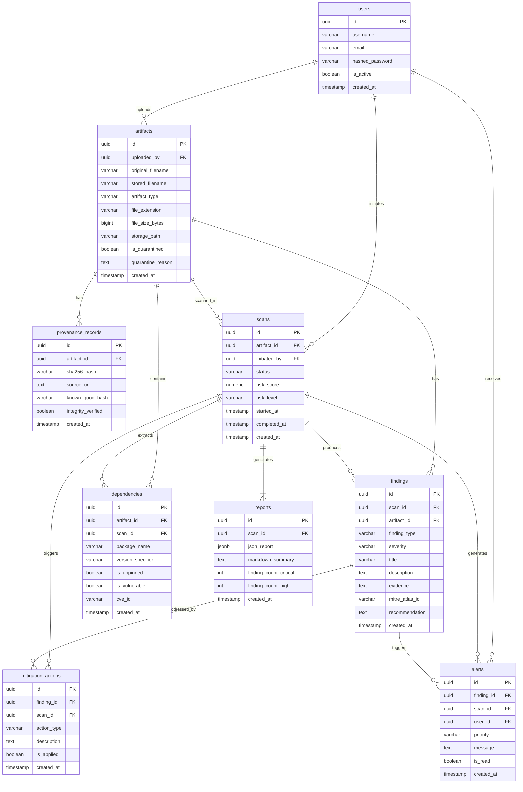

# AISecGuard — Database Design

**Project:** AISecGuard: Automated Framework for Detecting, Preventing, and Mitigating AI Supply Chain Attacks  
**Week:** 2  
**Document Type:** Database Design  
**Author:** MCA 3rd Semester Student  
**Date:** September 2026  
**Database:** PostgreSQL 15  
**ORM:** SQLAlchemy  

---

## Table of Contents

1. [Design Principles](#1-design-principles)
2. [Entity Overview](#2-entity-overview)
3. [Table Definitions](#3-table-definitions)
4. [Entity-Relationship Diagram](#4-entity-relationship-diagram)
5. [Key Relationships](#5-key-relationships)
6. [Notes on Implementation](#6-notes-on-implementation)

---

## 1. Design Principles

- **Simplicity first** — The database is designed to be straightforward and explainable for an academic project.
- **Normalised where practical** — Related data is separated into its own table rather than duplicated.
- **UUID primary keys** — All primary keys use UUID to avoid enumerable integer IDs in API responses.
- **Timestamps everywhere** — Every record stores `created_at` for audit trail purposes.
- **No over-engineering** — Only tables needed for the defined functional requirements are created.

---

## 2. Entity Overview

| Table | Purpose |
|---|---|
| `users` | Stores registered users and their authentication details |
| `artifacts` | Tracks uploaded files (models, datasets, dependency files) |
| `provenance_records` | Records origin, hash, and metadata for each artifact |
| `scans` | Each security scan run against an artifact |
| `findings` | Individual security findings produced by a scan |
| `dependencies` | Parsed packages extracted from dependency files |
| `mitigation_actions` | Mitigation actions taken or recommended per finding |
| `reports` | Generated security reports linked to scans |
| `alerts` | Notifications generated for high-severity findings |

---

## 3. Table Definitions

### 3.1 `users`

| Column | Type | Key | Nullable | Description |
|---|---|---|---|---|
| `id` | UUID | PK | No | Unique user identifier |
| `username` | VARCHAR(64) | UNIQUE | No | Login username |
| `email` | VARCHAR(255) | UNIQUE | No | User email address |
| `hashed_password` | VARCHAR(255) | | No | bcrypt-hashed password |
| `is_active` | BOOLEAN | | No | Account active status (default: true) |
| `created_at` | TIMESTAMP | | No | Account creation timestamp (UTC) |

---

### 3.2 `artifacts`

| Column | Type | Key | Nullable | Description |
|---|---|---|---|---|
| `id` | UUID | PK | No | Unique artifact identifier |
| `uploaded_by` | UUID | FK → users.id | No | User who uploaded the artifact |
| `original_filename` | VARCHAR(255) | | No | Original file name as uploaded |
| `stored_filename` | VARCHAR(255) | | No | UUID-based filename on disk (sanitised) |
| `artifact_type` | VARCHAR(32) | | No | `model`, `dataset`, `dependency` |
| `file_extension` | VARCHAR(16) | | No | File extension (`.pkl`, `.csv`, etc.) |
| `file_size_bytes` | BIGINT | | No | File size in bytes |
| `storage_path` | VARCHAR(512) | | No | Absolute path to stored file |
| `is_quarantined` | BOOLEAN | | No | Quarantine status (default: false) |
| `quarantine_reason` | TEXT | | Yes | Reason for quarantine (if applicable) |
| `created_at` | TIMESTAMP | | No | Upload timestamp (UTC) |

---

### 3.3 `provenance_records`

| Column | Type | Key | Nullable | Description |
|---|---|---|---|---|
| `id` | UUID | PK | No | Unique provenance record ID |
| `artifact_id` | UUID | FK → artifacts.id | No | Associated artifact |
| `sha256_hash` | VARCHAR(64) | | No | SHA-256 hash of the artifact file |
| `source_url` | TEXT | | Yes | URL where artifact was downloaded from (user-supplied) |
| `source_description` | TEXT | | Yes | Human description of the artifact source |
| `known_good_hash` | VARCHAR(64) | | Yes | Expected hash for integrity comparison (user-supplied) |
| `integrity_verified` | BOOLEAN | | Yes | True if hash matched known-good hash |
| `integrity_checked_at` | TIMESTAMP | | Yes | Timestamp of last integrity check |
| `created_at` | TIMESTAMP | | No | Record creation timestamp (UTC) |

---

### 3.4 `scans`

| Column | Type | Key | Nullable | Description |
|---|---|---|---|---|
| `id` | UUID | PK | No | Unique scan identifier |
| `artifact_id` | UUID | FK → artifacts.id | No | Artifact being scanned |
| `initiated_by` | UUID | FK → users.id | No | User who initiated the scan |
| `status` | VARCHAR(16) | | No | `PENDING`, `RUNNING`, `COMPLETED`, `FAILED` |
| `risk_score` | NUMERIC(4,2) | | Yes | Overall risk score 0.00–10.00 |
| `risk_level` | VARCHAR(16) | | Yes | `MINIMAL`, `LOW`, `MEDIUM`, `HIGH`, `CRITICAL` |
| `error_message` | TEXT | | Yes | Error details if scan failed |
| `started_at` | TIMESTAMP | | Yes | Scan start timestamp |
| `completed_at` | TIMESTAMP | | Yes | Scan completion timestamp |
| `created_at` | TIMESTAMP | | No | Scan record creation timestamp |

---

### 3.5 `findings`

| Column | Type | Key | Nullable | Description |
|---|---|---|---|---|
| `id` | UUID | PK | No | Unique finding identifier |
| `scan_id` | UUID | FK → scans.id | No | Scan that produced this finding |
| `artifact_id` | UUID | FK → artifacts.id | No | Artifact associated with finding |
| `finding_type` | VARCHAR(64) | | No | Short code identifying the finding type |
| `severity` | VARCHAR(16) | | No | `CRITICAL`, `HIGH`, `MEDIUM`, `LOW`, `INFO` |
| `title` | VARCHAR(255) | | No | Short, human-readable finding title |
| `description` | TEXT | | No | Detailed description of the finding |
| `evidence` | TEXT | | Yes | Technical evidence for the finding |
| `attack_name` | VARCHAR(255) | | Yes | Mapped attack name from detection engine |
| `mitre_atlas_id` | VARCHAR(32) | | Yes | MITRE ATLAS technique ID (e.g., AML.T0010) |
| `owasp_llm_id` | VARCHAR(16) | | Yes | OWASP LLM category (e.g., LLM04) |
| `recommendation` | TEXT | | Yes | Remediation recommendation |
| `created_at` | TIMESTAMP | | No | Finding creation timestamp |

---

### 3.6 `dependencies`

| Column | Type | Key | Nullable | Description |
|---|---|---|---|---|
| `id` | UUID | PK | No | Unique dependency record ID |
| `artifact_id` | UUID | FK → artifacts.id | No | Dependency file artifact |
| `scan_id` | UUID | FK → scans.id | No | Scan during which this was extracted |
| `package_name` | VARCHAR(128) | | No | Normalised package name |
| `version_specifier` | VARCHAR(64) | | Yes | Version specifier as written in the file |
| `is_unpinned` | BOOLEAN | | No | True if no version specifier was found |
| `is_vulnerable` | BOOLEAN | | No | True if matched in vulnerability database |
| `cve_id` | VARCHAR(32) | | Yes | CVE identifier if vulnerable |
| `cve_severity` | VARCHAR(16) | | Yes | CVE severity if applicable |
| `created_at` | TIMESTAMP | | No | Record creation timestamp |

---

### 3.7 `mitigation_actions`

| Column | Type | Key | Nullable | Description |
|---|---|---|---|---|
| `id` | UUID | PK | No | Unique mitigation action ID |
| `finding_id` | UUID | FK → findings.id | No | Finding this action addresses |
| `scan_id` | UUID | FK → scans.id | No | Scan associated with this action |
| `action_type` | VARCHAR(32) | | No | `QUARANTINE`, `ALERT`, `RECOMMENDATION` |
| `description` | TEXT | | No | Description of the mitigation action taken |
| `is_applied` | BOOLEAN | | No | Whether the action has been applied |
| `created_at` | TIMESTAMP | | No | Action creation timestamp |

---

### 3.8 `reports`

| Column | Type | Key | Nullable | Description |
|---|---|---|---|---|
| `id` | UUID | PK | No | Unique report identifier |
| `scan_id` | UUID | FK → scans.id | UNIQUE | One report per scan |
| `json_report` | JSONB | | No | Full structured JSON report |
| `markdown_summary` | TEXT | | Yes | Human-readable Markdown summary |
| `finding_count_critical` | INTEGER | | No | Count of CRITICAL findings |
| `finding_count_high` | INTEGER | | No | Count of HIGH findings |
| `finding_count_medium` | INTEGER | | No | Count of MEDIUM findings |
| `finding_count_low` | INTEGER | | No | Count of LOW findings |
| `finding_count_info` | INTEGER | | No | Count of INFO findings |
| `created_at` | TIMESTAMP | | No | Report generation timestamp |

---

### 3.9 `alerts`

| Column | Type | Key | Nullable | Description |
|---|---|---|---|---|
| `id` | UUID | PK | No | Unique alert identifier |
| `finding_id` | UUID | FK → findings.id | No | Finding that triggered the alert |
| `scan_id` | UUID | FK → scans.id | No | Associated scan |
| `user_id` | UUID | FK → users.id | No | User to be notified |
| `priority` | VARCHAR(16) | | No | `CRITICAL` or `HIGH` |
| `message` | TEXT | | No | Alert message text |
| `is_read` | BOOLEAN | | No | Whether user has acknowledged the alert |
| `created_at` | TIMESTAMP | | No | Alert creation timestamp |

---

## 4. Entity-Relationship Diagram

---

## 5. Key Relationships

| Relationship | Type | Description |
|---|---|---|
| `users` → `artifacts` | One-to-Many | A user can upload many artifacts |
| `users` → `scans` | One-to-Many | A user can initiate many scans |
| `artifacts` → `provenance_records` | One-to-Many | Each artifact can have multiple provenance records (re-uploads) |
| `artifacts` → `scans` | One-to-Many | An artifact can be scanned multiple times |
| `scans` → `findings` | One-to-Many | A scan produces multiple findings |
| `scans` → `reports` | One-to-One | Each completed scan has exactly one report |
| `findings` → `mitigation_actions` | One-to-Many | Each finding can have one or more mitigation actions |
| `findings` → `alerts` | One-to-Many | Critical/High findings generate alerts |

---

## 6. Notes on Implementation

1. **UUID generation** — Python `uuid.uuid4()` used to generate all primary keys.
2. **Timestamps** — All timestamps stored in UTC using `datetime.utcnow()` (will be migrated to `datetime.now(timezone.utc)` per Python 3.12 best practice).
3. **JSONB for reports** — PostgreSQL JSONB type used for `reports.json_report` to allow efficient querying of report content in future.
4. **Migrations** — Alembic will be used for database migrations (planned from Week 3).
5. **Indexes** — Production-scale indexes are not implemented in the MVP; they should be added if performance becomes an issue:
   - Index on `scans.artifact_id`
   - Index on `findings.scan_id`
   - Index on `findings.severity`
