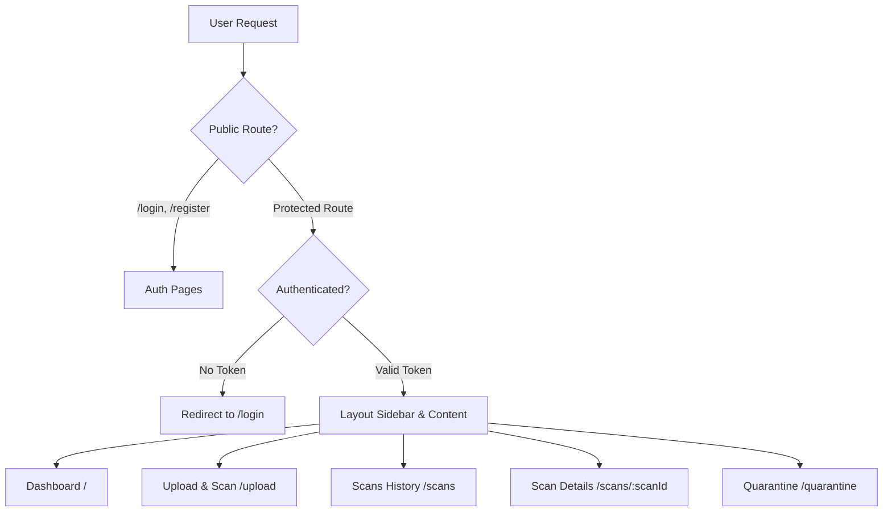

# AISecGuard — Frontend Architecture Document (Week 5)

## 1. Overview

AISecGuard's frontend is a modern, high-performance Single Page Application (SPA) designed to provide security analysts, ML engineers, and compliance auditors with real-time visibility into AI supply chain threats, model inspection findings, and quarantine controls.

### Technology Stack
- **Framework:** React 19 + Vite 6
- **Styling:** Tailwind CSS v4 + Custom Dark-Theme Glassmorphism Design System
- **Routing:** React Router v7
- **Data Visualization:** Recharts (donut risk distribution & severity bar charts)
- **File Ingestion:** `react-dropzone` with drag-and-drop support
- **HTTP Client:** Axios with JWT auto-attach, 401 interceptors, and typed API service helpers

---

## 2. Directory Structure

```text
frontend/
├── index.html                   # HTML entry point with Inter & JetBrains Mono fonts
├── vite.config.js               # Vite config with @tailwindcss/vite plugin & backend proxy
├── package.json
└── src/
    ├── main.jsx                 # React root rendering App component
    ├── App.jsx                  # Main router, route protections, and layout provider
    ├── index.css                # Tailwind v4 import & custom CSS design tokens
    ├── api/
    │   └── client.js            # Axios client, JWT interceptor, refresh logic, API services
    ├── context/
    │   └── AuthContext.jsx      # React AuthContext (JWT persistence, /me user profile)
    ├── components/
    │   └── Layout.jsx           # Sidebar navigation, brand identity, user profile & logout
    └── pages/
        ├── LoginPage.jsx        # JWT login form with validation & error handling
        ├── RegisterPage.jsx     # Registration form with live password-strength meter
        ├── DashboardPage.jsx    # Metrics cards, risk distribution donut, recent scans table
        ├── UploadPage.jsx       # 3-step drag-and-drop artifact scanner (Model/Dataset/Dep)
        ├── ScansPage.jsx        # Paginated scan history with status/risk filtering
        ├── ScanDetailPage.jsx   # Circular score gauge, collapsible findings, PDF/JSON export
        └── QuarantinePage.jsx   # Quarantined artifacts table, release modal & audit log
```

---

## 3. Application Routing & Protected Routes



### Route Definitions
| Path | Component | Access | Purpose |
|---|---|---|---|
| `/login` | `LoginPage` | Public | Authenticate user credentials, obtain access & refresh JWTs |
| `/register` | `RegisterPage` | Public | Account creation with password security validation |
| `/` | `DashboardPage` | Protected | Aggregated system security overview and scan metrics |
| `/upload` | `UploadPage` | Protected | Multi-format artifact upload and automated scan trigger |
| `/scans` | `ScansPage` | Protected | Filterable scan inventory and status history |
| `/scans/:scanId` | `ScanDetailPage` | Protected | Deep-dive findings inspection, evidence viewer, report download |
| `/quarantine` | `QuarantinePage` | Protected | Containment management, isolation reasons, and audit trail |

---

## 4. Authentication & State Flow

1. **Token Storage:** Access and Refresh JWT tokens are securely saved in browser `localStorage`.
2. **Session Hydration:** On application mount, `AuthContext` queries `GET /api/v1/auth/me` with the stored access token to populate active user context.
3. **Automatic Interceptors:**
   - **Request Interceptor:** Automatically adds `Authorization: Bearer <token>` to outbound API requests.
   - **Response Interceptor:** On receiving HTTP 401, issues a silent POST `/api/v1/auth/refresh` using the refresh token, retrying the failed request with the new access token. If refresh fails, tokens are evicted and the user is redirected to `/login`.

---

## 5. Visual Design System

The UI implements a dark-mode first, cyber-security aesthetic:
- **Backgrounds:** Deep slate tones (`#0a0e17`, `#0f172a`, `#1e293b`) with frosted-glass card containers (`backdrop-blur-md`).
- **Accent Palettes:** Cyan (`#06b6d4`), Emerald (`#10b981`), Amber (`#f59e0b`), Rose (`#f43f5e`), and Violet (`#8b5cf6`).
- **Severity Badges:**
  - `CRITICAL`: Bright red badge with glowing halo (`#ef4444`)
  - `HIGH`: Orange badge (`#f97316`)
  - `MEDIUM`: Amber badge (`#f59e0b`)
  - `LOW`: Emerald badge (`#10b981`)
  - `INFORMATIONAL`: Slate blue badge (`#64748b`)
