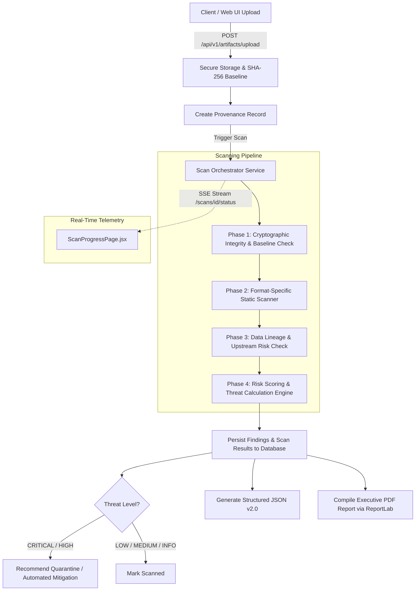

# 🛡️ AISecGuard: Architecture, Scanning Engine & Report Generation Guide

> **Project:** Automated Framework for Detecting, Preventing, and Mitigating AI Supply Chain Attacks  
> **Course:** MCA 3rd Semester Project  
> **Target Audience:** Developers, Evaluators, and Security Analysts  

---

## 📌 Table of Contents
1. [Core Design Principle: Zero-Execution Analysis](#1-core-design-principle-zero-execution-analysis)
2. [End-to-End System Workflow](#2-end-to-end-system-workflow)
3. [Step-by-Step Lifecycle (Ingestion to Quarantine)](#3-step-by-step-lifecycle-ingestion-to-quarantine)
4. [Deep Dive: AI Model Security Scanner](#4-deep-dive-ai-model-security-scanner)
5. [Deep Dive: Dataset Security Scanner](#5-deep-dive-dataset-security-scanner)
6. [Threat Calculation & Risk Scoring Engine](#6-threat-calculation--risk-scoring-engine)
7. [Automated Report Generation (JSON & PDF)](#7-automated-report-generation-json--pdf)
8. [Hands-On Testing Guide (Step-by-Step Tutorial)](#8-hands-on-testing-guide-step-by-step-tutorial)
9. [Summary of Rules & Detection Catalog](#9-summary-of-rules--detection-catalog)

---

## 1. Core Design Principle: Zero-Execution Analysis

Traditional antivirus and dynamic malware analyzers execute code inside isolated sandboxes. **AISecGuard takes a fundamentally different, safer approach:**

```
┌────────────────────────────────────────────────────────────────────────┐
│                        CRITICAL SAFETY RULES                           │
│  1. Files are NEVER loaded, deserialized, imported, or executed.       │
│  2. pickle.load(), eval(), exec(), and torch.load() are FORBIDDEN.     │
│  3. No model objects or dataset scripts are ever instantiated.         │
│  4. 100% of checks rely on byte-level inspection, opcode walking,      │
│     and static mathematical statistics.                                │
└────────────────────────────────────────────────────────────────────────┘
```

This ensures that even if an attacker uploads a devastating zero-day ransomware or reverse-shell payload, the AISecGuard backend server can **never be compromised**.

---

## 2. End-to-End System Workflow

The following flowchart illustrates the automated lifecycle when an artifact is uploaded:



---

## 3. Step-by-Step Lifecycle (Ingestion to Quarantine)

### Step 1: Upload & Safe Storage
* The client uploads an AI model (`.pkl`, `.safetensors`, `.onnx`, `.pt`, `.h5`) or dataset (`.csv`, `.parquet`, `.json`, `.jsonl`).
* The backend (`artifacts.py`) validates file extensions and ensures size limits (default: 100 MB).
* The file is saved using a **UUID-based sanitized filename** in the storage directory to prevent Path Traversal attacks (`../../etc/passwd`).
* The original filename is stored strictly as metadata.

### Step 2: Cryptographic SHA-256 Fingerprinting
* The backend computes an immediate streaming SHA-256 digest of the raw bytes.
* A `ProvenanceRecord` is inserted into SQLite/PostgreSQL containing:
  * `sha256_hash`: Immutable upload baseline.
  * `expected_sha256`: Optional hash supplied by the vendor/hub.
  * `source_url`: Origin repository (e.g., Hugging Face URL).

### Step 3: Real-Time SSE Status Stream
* The client connects to `GET /api/v1/scans/{scan_id}/status` using Server-Sent Events (SSE).
* The backend streams real-time progress:
  1. `QUEUED` (Progress: 20%)
  2. `PROVENANCE_CHECK` (Progress: 40%)
  3. `SCANNER_RUNNING` (Progress: 70%)
  4. `RISK_CALC` (Progress: 90%)
  5. `COMPLETED` (Progress: 100%)

### Step 4: Execution of Static Scanners
* The orchestrator selects the correct scanner based on artifact type:
  * `ArtifactType.MODEL` → `ModelScanner` (`model_scanner.py`)
  * `ArtifactType.DATASET` → `DatasetScanner` (`dataset_scanner/scanner.py`)
  * `ArtifactType.DEPENDENCY` → `DependencyScanner` (`dependency_scanner/scanner.py`)

### Step 5: Lineage Propagation Check
* If the artifact is linked to a parent (e.g., a fine-tuned model trained on a specific dataset), `lineage_service.py` checks whether the parent has unresolved vulnerabilities.
* High upstream risks are propagated downward as `LIN-001`.

### Step 6: Risk Calculation & Scoring
* All collected findings are passed to `risk_engine.py`.
* A numeric threat score ($0 \le \text{score} \le 50$) and tier are computed.

### Step 7: Persistence & Report Ready
* The scan status is marked `COMPLETED`.
* Full reports are accessible immediately via JSON or compiled PDF download.

---

## 4. Deep Dive: AI Model Security Scanner

Located in: `backend/app/scanners/model_scanner.py`

### 1. Pickle Opcode Walking (`.pkl`, `.joblib`, `.pt`, `.bin`)
Python's pickle is an interpreted, stack-based language. Instead of running `pickle.load()`, AISecGuard disassembles the byte stream using `pickletools.genops(stream)`.

* **Virtual Stack Simulation:**
  * Tracks string allocations (`SHORT_BINUNICODE`, `BINBYTES`).
  * Tracks memoization dictionaries (`PUT`, `GET`, `MEMOIZE`).
  * Resolves `STACK_GLOBAL` and `GLOBAL` opcodes into exact `(module, callable)` tuples.
* **Denylist Interception:**
  Matches tuples against known attack vectors:
  ```python
  DANGEROUS_CALLABLES = {
      ("os", "system"), ("nt", "system"), ("posix", "system"),
      ("subprocess", "Popen"), ("subprocess", "run"), ("subprocess", "call"),
      ("builtins", "eval"), ("builtins", "exec"), ("builtins", "__import__"),
      ("socket", "socket"), ("os", "popen"), ("pty", "spawn")
  }
  ```
  * **Result:** Triggers **`MODEL-002: CRITICAL`** if any malicious callable is detected.

### 2. SafeTensors Header Struct Parser (`.safetensors`)
SafeTensors stores tensors in raw binary, preceded by an 8-byte little-endian header length prefix $N$, followed by $N$ bytes of JSON metadata.
* **Inspection Process:**
  1. Reads the first 8 bytes and unrolls `<Q` (unsigned 64-bit integer).
  2. Ensures header length is reasonable ($< 100\text{ MB}$) to prevent memory exhaustion attacks.
  3. Parses the header JSON safely.
  4. Inspects metadata keys for suspicious keywords (`eval`, `exec`, `shell`).
  * **Result:** Valid SafeTensors produces **`MODEL-006: INFORMATIONAL`** (Clean).

### 3. ONNX Protobuf Structure Inspection (`.onnx`)
* Evaluates raw protobuf varints without calling an ONNX runtime.
* Counts GraphProto nodes (`tag 0x0A`) to calculate graph density and flag bloated or crafted obfuscation attempts.
* **Result:** Produces **`MODEL-010: INFORMATIONAL`**.

### 4. Byte-Level Signature Telemetry
* Scans non-pickle binary buffers for embedded OS commands (`/bin/sh`, `cmd.exe`, `requests.get`, `base64.b64decode`).
* **Result:** Produces **`MODEL-009: HIGH`** on suspicious pattern discovery.

---

## 5. Deep Dive: Dataset Security Scanner

Located in: `backend/app/scanners/dataset_scanner/scanner.py`

The dataset scanner analyzes tabular and columnar data (`.csv`, `.json`, `.jsonl`, `.parquet`) using memory-safe PyArrow and Pandas readers.

### 1. CSV / Formula Injection (DDE) Detection
* **Threat:** Threat actors embed spreadsheet formulas into dataset cells or column headers to achieve code execution when an analyst opens exported data in Microsoft Excel or LibreOffice Calc.
* **Check:**
  ```python
  SUSPICIOUS_COL_PREFIXES = ("=", "+", "-", "@", "|")
  ```
  If headers or values begin with command characters (e.g., `=cmd|'/C calc'!A0`), the scanner triggers **`DATA-006: LOW/MEDIUM`**.

### 2. Extreme Numerical Outliers (Data Poisoning)
* **Threat:** Backdoor attackers introduce extreme numerical values to shift model decision boundaries or skew gradient descent.
* **Check:** For every numeric column, calculates mean $\mu$ and standard deviation $\sigma$.
  $$\text{Z-score} = \frac{|x - \mu|}{\sigma}$$
  If $\max(\text{Z-score}) > 5.0$, triggers **`DATA-008: MEDIUM`**.

### 3. Duplicate Row Concentration
* **Threat:** Attackers duplicate malicious samples to artificially amplify their training weight without expanding dataset volume.
* **Check:** Flags datasets where duplicate rows exceed **30.0%** of total rows (**`DATA-007: MEDIUM`**).

### 4. Severe Class Imbalance (Label Skew)
* **Threat:** Targeted label manipulation where a critical label is artificially suppressed or inflated.
* **Check:** Evaluates categorical candidate columns. If any single class comprises $\ge 90.0\%$ of rows, triggers **`DATA-009: LOW`**.

---

## 6. Threat Calculation & Risk Scoring Engine

Located in: `backend/app/services/risk_engine.py`

Every identified security finding carries a severity weight:

| Severity Level | Weight Points | Definition |
| :--- | :---: | :--- |
| **CRITICAL** | **10** | Direct Remote Code Execution (e.g., `os.system` in pickle opcodes). |
| **HIGH** | **6** | Known unsafe serialization format, tampered SHA-256 baseline. |
| **MEDIUM** | **3** | SafeTensors structural anomalies, high data duplicates, extreme outliers. |
| **LOW** | **1** | Formula injection prefix, class imbalance skew, missing values. |
| **INFORMATIONAL** | **0** | Clean SafeTensors/ONNX format confirmation, metadata telemetry. |

### Formula
$$\text{Risk Score} = \min\left(50, \sum_{i=1}^{n} \text{Weight}(\text{Finding}_i)\right)$$

### Risk Tier Thresholds
* **LOW:** $\text{Score} < 5$
* **MEDIUM:** $5 \le \text{Score} \le 14$
* **HIGH:** $15 \le \text{Score} \le 29$
* **CRITICAL:** $\text{Score} \ge 30$ *(or contains at least 3 critical vulnerabilities)*

---

## 7. Automated Report Generation (JSON & PDF)

Located in: `backend/app/api/v1/endpoints/reports.py`

### 1. JSON Remediation Report (`GET /api/v1/scans/{id}/report?format=json`)
Machine-readable payload containing complete audit metadata:
```json
{
  "report_generated_at": "2026-11-08T19:30:00Z",
  "schema_version": "2.0",
  "artifact": {
    "id": "11a6646b-81d0-408e-8e54-2527f4ea3914",
    "original_filename": "malicious_model.pkl",
    "artifact_type": "MODEL",
    "file_size_bytes": 1048,
    "sha256": "e3b0c44298fc1c149afbf4c8996fb92427ae41e4649b934ca495991b7852b855"
  },
  "scan": {
    "id": "d8d833d8-2d12-4650-9234-35632081af6d",
    "status": "COMPLETED",
    "risk_level": "CRITICAL",
    "risk_score": 16,
    "duration_seconds": 0.018
  },
  "summary": {
    "total_findings": 2,
    "critical_count": 1,
    "high_count": 1,
    "medium_count": 0,
    "low_count": 0
  },
  "scan_phases": [
    "1. Provenance & Integrity Check (SHA-256 baseline verification)",
    "2. MODEL Static Security Scanner (format-specific static byte analysis)",
    "3. Lineage Risk Check (upstream dependency & model propagation checks)",
    "4. Risk Assessment Engine (severity-weighted numeric threat score)"
  ],
  "findings": [
    {
      "rule_id": "MODEL-002",
      "severity": "CRITICAL",
      "title": "Suspicious module/callable references found in pickle opcodes",
      "description": "Static inspection found references to os.system.",
      "evidence": "Suspicious GLOBAL references found:\n  - os.system",
      "recommendation": "DO NOT deserialize this artifact. Reject or quarantine this file."
    }
  ],
  "disclaimer": "This report is generated via automated static security heuristics. No untrusted code was executed."
}
```

### 2. Executive PDF Report (`GET /api/v1/scans/{id}/report?format=pdf`)
Compiled using **ReportLab**:
* **Header & Styling:** Clean typography, formal enterprise slate/blue palette.
* **Artifact Metadata Table:** Filename, payload size, upload timestamp, cryptographic SHA-256 fingerprint.
* **Threat Scorecard:** Color-coded threat tier badge (`#dc2626` Critical, `#ea580c` High, `#ca8a04` Medium, `#16a34a` Low), numeric score, and duration.
* **Phase Telemetry:** Checkmarks detailing verified security layers.
* **Detailed Findings & Mitigations:** Enumerated findings with extracted byte evidence and prescribed remediation steps.

---

## 8. Hands-On Testing Guide (Step-by-Step Tutorial)

### Step 1: Launch Backend Server
```powershell
cd "d:\MCA 3rd SEM\project\AISecGuard\backend"
python -m uvicorn main:app --host 0.0.0.0 --port 8000 --reload
```
* Verify: Open `http://localhost:8000/health` (should return `{"status": "ok"}`).

### Step 2: Launch Frontend Client
```powershell
cd "d:\MCA 3rd SEM\project\AISecGuard\frontend"
npm run dev
```
* Open your browser to `http://localhost:5173`.

### Step 3: Run Test Scans

#### Test A: Malicious Model Exploit (Critical Alert)
1. Go to the **Upload & Scan** page (`/upload`).
2. Drag and drop:  
   `samples/models/malicious_os_system_proto4.pkl`
3. Click **Scan 1 file**.
4. The screen redirects to the live progress screen (`/scans/{id}/progress`) showing the 5 scan phases animate.
5. On completion, examine the **Inspection Report**:
   * **Threat Score:** $\ge 16$ (**CRITICAL**).
   * **Rule Flagged:** `MODEL-002` (References `os.system`).
   * **Action:** Click **Quarantine Artifact** to isolate the file.

#### Test B: Clean SafeTensors Model (Safe Baseline)
1. In `/upload`, drop:  
   `samples/models/safe_model.safetensors`
2. Click **Scan 1 file**.
3. Expected result:
   * **Threat Score:** $0$ (**INFORMATIONAL** / Clean).
   * **Rule Flagged:** `MODEL-006` (Safe format verified).

#### Test C: Poisoned Dataset (Outlier Anomaly)
1. In `/upload`, drop:  
   `samples/datasets/poisoned_numerical_outliers.csv`
2. Click **Scan 1 file**.
3. Expected result:
   * **Threat Score:** Flagged as **MEDIUM**.
   * **Rule Flagged:** `DATA-008` (Extreme numerical z-scores detected).

### Step 4: Export Reports
* On any scan detail page, click **JSON Report** or **PDF Report** in the top-right corner to download your audit file.

---

## 9. Summary of Rules & Detection Catalog

| Rule ID | Module | Title | Default Severity | Threat Type |
| :--- | :--- | :--- | :---: | :--- |
| **`PROV-001`** | Integrity | Artifact modified since baseline recorded | **HIGH** | Tampering / Unauthorized Modification |
| **`PROV-002`** | Integrity | SHA-256 does not match expected publisher hash | **HIGH** | Hash Mismatch / Substitution |
| **`MODEL-001`** | Model | Pickle-based serialization format detected | **HIGH** | Inherent Format Risk |
| **`MODEL-002`** | Model | Suspicious callable references (`os.system`, `eval`) | **CRITICAL** | Remote Code Execution (RCE) |
| **`MODEL-003`** | Model | PyTorch ZIP / legacy pickle archive detected | **MEDIUM / HIGH** | Unsafe Weights Archive |
| **`MODEL-004`** | Model | HDF5 format / lambda layer inspection | **MEDIUM** | Arbitrary Object Execution |
| **`MODEL-006`** | Model | SafeTensors format header verification | **INFORMATIONAL** | Safe Format Benchmark |
| **`MODEL-006b`**| Model | Suspicious metadata keys in SafeTensors | **MEDIUM** | Obfuscated Metadata Payload |
| **`MODEL-009`** | Model | Suspicious string patterns in binary (shells/URLs) | **HIGH** | Embedded Shell Script |
| **`MODEL-010`** | Model | ONNX static protobuf inspection completed | **INFORMATIONAL** | Safe Open Format Benchmark |
| **`DATA-001`** | Dataset | Empty dataset file (0 bytes) | **MEDIUM** | Data Extraction Failure |
| **`DATA-006`** | Dataset | Suspicious column names (`=`, `@`, `+`, `-`) | **LOW** | CSV / DDE Formula Injection |
| **`DATA-007`** | Dataset | High duplicate row concentration (>30%) | **MEDIUM** | Data Poisoning / Inflation |
| **`DATA-008`** | Dataset | Extreme numerical outliers (z-score > 5.0) | **MEDIUM** | Feature Perturbation / Backdoor |
| **`DATA-009`** | Dataset | Highly imbalanced class distribution (>90%) | **LOW** | Target Label Manipulation |
| **`DATA-010`** | Dataset | High missing value rate (>50%) | **LOW** | Data Corruption / Deliberate Drop |
| **`LIN-001`** | Lineage | Inherited upstream risk from parent model/dataset | **HIGH** | AI Supply Chain Contamination |

