# 01 — Master End-to-End System Flowchart
### AISecGuard: AI Supply Chain Security & Governance Platform

---

## Architecture Flowchart

```mermaid
flowchart TD
    %% Styling & Theme Setup
    classDef client fill:#3b82f6,stroke:#1d4ed8,stroke-width:2px,color:#ffffff;
    classDef gateway fill:#6366f1,stroke:#4338ca,stroke-width:2px,color:#ffffff;
    classDef engine fill:#8b5cf6,stroke:#6d28d9,stroke-width:2px,color:#ffffff;
    classDef decision fill:#f59e0b,stroke:#d97706,stroke-width:2px,color:#ffffff;
    classDef quarantine fill:#ef4444,stroke:#b91c1c,stroke-width:2px,color:#ffffff;
    classDef safe fill:#10b981,stroke:#047857,stroke-width:2px,color:#ffffff;
    classDef storage fill:#0284c7,stroke:#0369a1,stroke-width:2px,color:#ffffff;

    subgraph CLIENT_LAYER ["1. Presentation & Client Layer (React 19 + Vite 6)"]
        A["User (SecOps / MLOps / Auditor)"]:::client
        B["React Dashboard UI"]:::client
        C["Upload Gateway (/upload)"]:::client
    end

    subgraph API_GATEWAY ["2. API & Control Gateway (FastAPI Backend)"]
        D["OAuth2 & JWT Bearer Authentication"]:::gateway
        E["Role-Based Access Control: ADMIN, ANALYST, AUDITOR"]:::gateway
        F["Upload Ingestion & Chunked File Buffer"]:::gateway
        G["Cryptographic SHA-256 Ingestion Baseline"]:::gateway
    end

    subgraph SCAN_ENGINE ["3. Zero-Execution Static Analysis Engine"]
        H{"Artifact Type Classification"}:::decision
        I["Model Scanner: Zero-Execution Pickle Opcode Disassembly"]:::engine
        J["Dataset Scanner: Statistical Z-Score & Poisoning Detection"]:::engine
        K["Dependency Scanner: OSV.dev CVE & Typosquat Analysis"]:::engine
        L["Aggregation & Heuristic Rule Engine"]:::engine
    end

    subgraph EVAL_ENGINE ["4. Risk Scoring & Policy Decision Engine"]
        M["Risk Score Calculator: 0-100 & Severity Matrix"]:::engine
        N{"Policy Evaluation Gate: Score <= Threshold?"}:::decision
    end

    subgraph QUARANTINE_LAYER ["5. Isolation & Remediation Layer"]
        O["Physical Isolation: Move to uploads/quarantine/"]:::quarantine
        P["Lock Artifact Status: QUARANTINED"]:::quarantine
        Q["Block Pipeline Loading & Serving Access"]:::quarantine
        R["Auditor Review & Manual Release with Justification"]:::quarantine
    end

    subgraph PROVENANCE_LAYER ["6. Provenance & Supply Chain Signing Layer"]
        S["Generate / Retrieve Ed25519 Private Key"]:::safe
        T["Cryptographically Sign Artifact SHA-256 Digest"]:::safe
        U["Generate ML-BOM & CycloneDX Manifest"]:::safe
        V["Link Provenance Lineage: Dataset -> Model -> Child"]:::safe
    end

    subgraph STORAGE_AUDIT ["7. Persistence & Audit Reporting Layer"]
        W[("Relational Database: SQLite WAL / PostgreSQL")]:::storage
        X["Activity Audit Trail & Security Alerts"]:::storage
        Y["ReportLab PDF Engine & JSON Compliance Exporters"]:::storage
    end

    %% Flows & Connections
    A -->|"1. Authenticates"| B
    B -->|"2. Selects artifact"| C
    C -->|"3. Multipart POST payload"| D
    D -->|"4. Token validated"| E
    E -->|"5. Dispatches request"| F
    F -->|"6. Computes digest"| G
    G -->|"7. Ingests raw bytes"| H

    H -->|"AI Model (.pkl, .pt, .onnx)"| I
    H -->|"Tabular Dataset (.csv, .parquet, .json)"| J
    H -->|"Dependency Manifest (requirements.txt)"| K

    I -->|"Opcodes & Callables"| L
    J -->|"Anomalies & Poison score"| L
    K -->|"CVEs & Typosquats"| L

    L -->|"Synthesized findings"| M
    M -->|"Calculates overall risk"| N

    N -->|"High / Critical Risk (Violates Policy)"| O
    O --> P --> Q --> R
    R -.->|"If released by Admin"| S

    N -->|"Clean / Low Risk (Passed Policy)"| S
    S --> T --> U --> V

    P -->|"Logs incident"| X
    T -->|"Stores signature"| W
    V -->|"Persists lineage graph"| W
    M -->|"Generates report"| Y
    Y -->|"Download PDF / JSON"| B
    X -->|"Real-time notification"| B
```

---

## Technical Summary of Layers

1. **Client Layer**: Responsive React 19 interface with Light/Dark mode, compact icon sidebar, and live telemetry.
2. **API Layer**: High-performance FastAPI ASGI server with JWT authentication and strict Role-Based Access Control.
3. **Scan Engine**: Pure static inspection guaranteeing zero execution of hostile bytecode.
4. **Risk & Policy Engine**: Mathematical threat scoring mapping multi-scanner detections to 0–100 risk levels.
5. **Isolation Vault**: Physical filesystem movement to `uploads/quarantine/` rendering hazardous files un-loadable.
6. **Provenance Layer**: Ed25519 asymmetric cryptography and CycloneDX 1.5 ML-BOM generation.
7. **Storage & Audit**: Persistent database storage with immutable activity audit logs.
