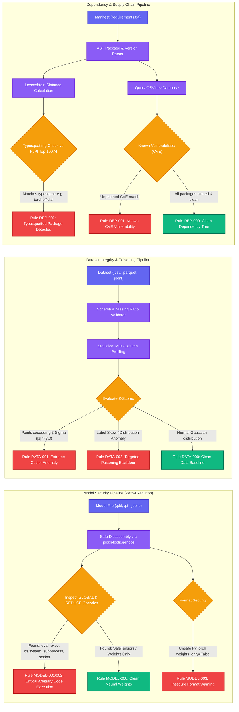

# 02 — Threat Detection & Scanning Pipeline Flowchart
### AISecGuard: Zero-Execution Static Analysis Heuristics

---

## Scanning Pipeline Flowchart

---

## Technical Details

### 1. Model Scanner (`app/services/model_scanner.py`)
- **Safe Pickle Opcode Disassembly**: Uses `pickletools.genops()` to parse the serialization byte stream without ever invoking Python's unpickler.
- **Dangerous Callables Flagged**: `posix.system`, `subprocess.Popen`, `builtins.eval`, `builtins.exec`, `socket.socket`, `os.system`.
- **Format Hardening**: Recommends modern unpicklable weight formats (`SafeTensors`, `ONNX`).

### 2. Dataset Scanner (`app/services/dataset_scanner.py`)
- **Multi-column Z-Score Anomaly**: Evaluates numeric distributions using $\mu$ and $\sigma$, flagging values with $|Z| > 3.0$.
- **Data Poisoning Heuristics**: Detects class imbalances, label skew, and backdoor trigger anomalies.

### 3. Dependency Scanner (`app/services/dependency_scanner.py`)
- **Typosquatting**: Calculates Levenshtein edit distance against verified AI packages (`torch`, `tensorflow`, `numpy`, `scikit-learn`, `transformers`).
- **CVE Correlation**: Queries the OSV.dev vulnerability database for known CVEs.
