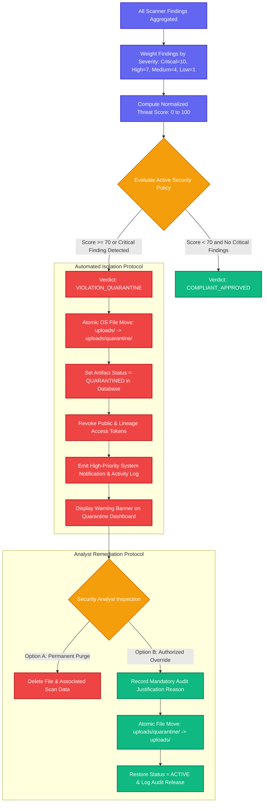

# 03 — Policy Enforcement & Quarantine Isolation Flowchart
### AISecGuard: Automated Threat Containment & Isolation Protocol

---

## Quarantine Isolation Flowchart

---

## Technical Details

### Scoring Formulation
- **Critical Severity**: Weight = 10 (Direct RCE, arbitrary bytecode execution)
- **High Severity**: Weight = 7 (Unpinned dependencies, severe label distribution skew)
- **Medium Severity**: Weight = 4 (Deprecated formats, unpinned packages)
- **Low Severity**: Weight = 1 (Informational notices)
- **Quarantine Threshold**: Any artifact with a normalized risk score $\ge 70$ or containing any `CRITICAL` finding is automatically isolated.

### File Isolation Mechanism
- Physical storage move to `uploads/quarantine/`.
- File permissions locked.
- Serving endpoints reject download requests with HTTP 403 Forbidden.
- Requires administrator override with logged justification to release.
