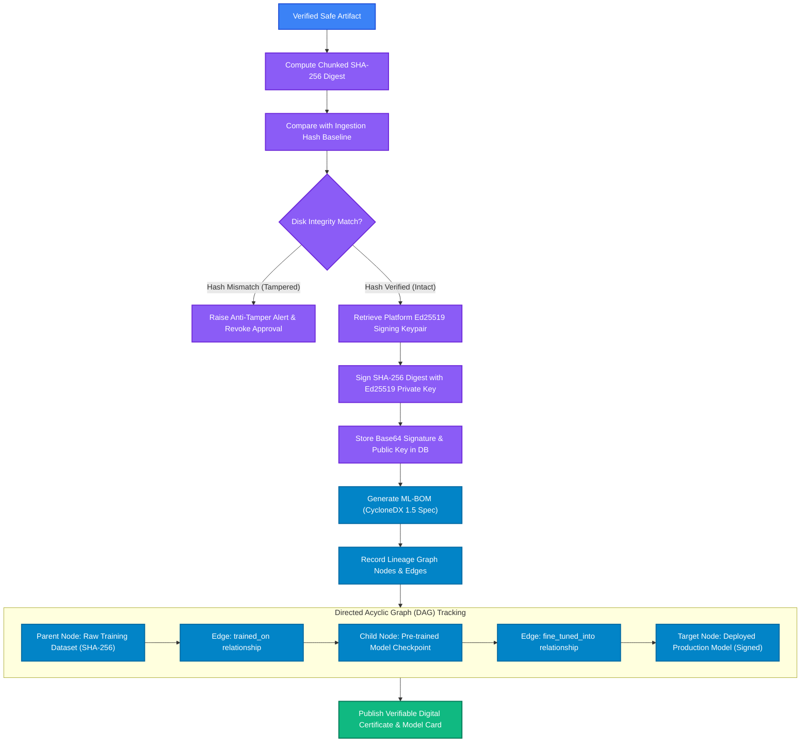

# 04 — Cryptographic Provenance & Ed25519 Signing Flowchart
### AISecGuard: Supply Chain Integrity & Lineage DAG

---

## Provenance & Signing Flowchart

---

## Technical Details

### 1. SHA-256 Cryptographic Baselines
- Chunked 64KB hashing upon initial ingestion.
- Background anti-tamper verifier re-computes hashes to detect silent on-disk corruption or unauthorized modifications.

### 2. Ed25519 Digital Signatures
- Uses Curve25519 high-speed elliptic curve digital signatures (`cryptography.hazmat.primitives.asymmetric.ed25519`).
- Signatures cannot be forged without the private platform key.
- Public key is distributed via `/api/v1/signing/public-key` for offline verification in MLOps CI/CD pipelines.

### 3. ML-BOM (Machine Learning Bill of Materials)
- Formatted according to CycloneDX 1.5 standards.
- Documents training dataset hashes, model architecture, hyperparameters, and framework dependencies.
