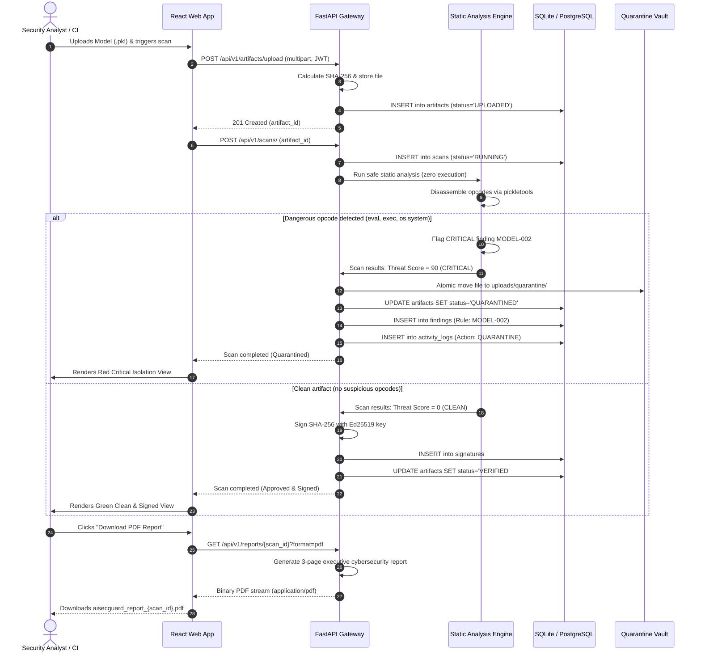

# 05 — End-to-End API Sequence Diagram
### AISecGuard: Client-Server Protocol & Communication Lifecycle

---

## API Sequence Diagram

---

## Technical Details

- **Protocol**: HTTP/1.1 and HTTP/2 over TLS with RESTful JSON payloads.
- **Authentication**: Bearer JWT tokens in `Authorization` header.
- **Payload Format**: Multipart/form-data for chunked file ingestion; application/json for metadata and scan telemetry; application/pdf for executive reports.
- **Database Transactions**: SQLAlchemy 2.0 with atomic commits and rollback on error.
