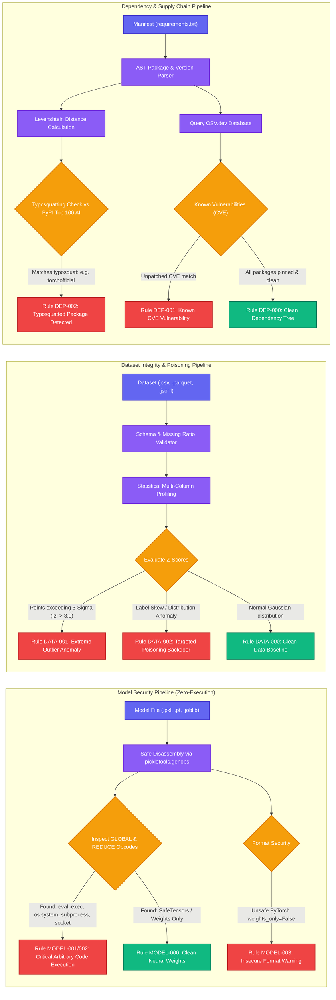
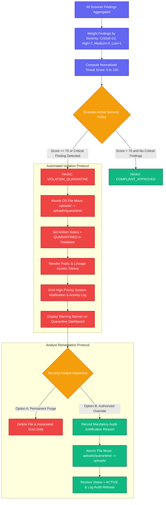
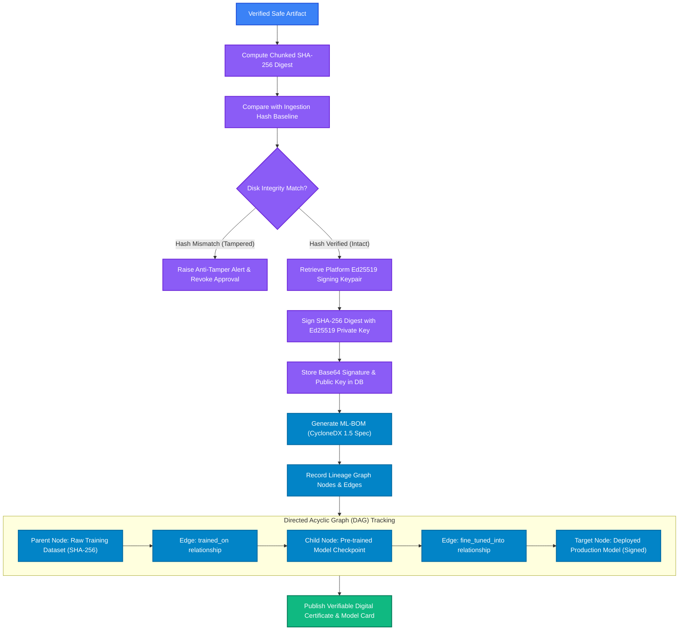
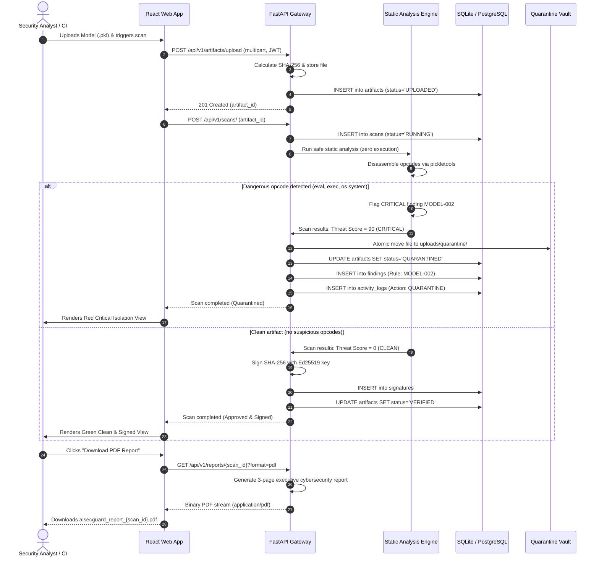

# 🛡️ AISecGuard — Complete Project Architecture & Flowcharts
### Automated Framework for Detecting, Preventing, and Mitigating AI Supply Chain Attacks

---

## 📌 Document Overview

This document provides the complete system architecture, operational workflows, and security verification pipelines for the **AISecGuard** platform. It contains **5 comprehensive flowchart diagrams** formatted with Mermaid, alongside technical explanations suitable for inclusion in the MCA Final Year Project Report and technical documentation.

---

## 📑 Table of Contents

1. [Master End-to-End System Flowchart](#1-master-end-to-end-system-flowchart)
2. [Deep-Dive Threat Detection & Scanning Pipeline](#2-deep-dive-threat-detection--scanning-pipeline)
3. [Policy Enforcement & Quarantine Isolation Workflow](#3-policy-enforcement--quarantine-isolation-workflow)
4. [Cryptographic Provenance & Ed25519 Signing Workflow](#4-cryptographic-provenance--ed25519-signing-workflow)
5. [End-to-End API Sequence Diagram](#5-end-to-end-api-sequence-diagram)
6. [Summary of Architectural Phases & Guarantees](#6-summary-of-architectural-phases--guarantees)

---

## 1. Master End-to-End System Flowchart

This diagram illustrates the complete end-to-end lifecycle of an AI asset within AISecGuard, from initial user upload through multi-stage static analysis, policy evaluation, automated isolation, cryptographic signing, and enterprise reporting.

```mermaid
flowchart TD
    %% Styling & Theme Setup
    classDef client fill:#3b82f6,stroke:#1d4ed8,stroke-width:2px,color:#ffffff;
    classDef gateway fill:#6366f1,stroke:#4338ca,stroke-width:2px,color:#ffffff;
    classDef engine fill:#8b5cf6,stroke:#6d28d9,stroke-width:2px,color:#ffffff;
    classDef decision fill:#f59e0b,stroke:#d97706,stroke-width:2px,color:#ffffff;
    classDef quarantine fill:#ef4444,stroke:#b91c1c,stroke-width:2px,color:#ffffff;
    classDef safe fill:#10b981,stroke:#047857,stroke-width:2px,color:#ffffff;
    classDef storage fill:#0284c7,stroke:#0369a1,stroke-width:2px,color:#ffffff;

    subgraph CLIENT_LAYER ["1. Presentation & Client Layer (React 19 + Vite 6)"]
        A["User (SecOps / MLOps / Auditor)"]:::client
        B["React Dashboard UI"]:::client
        C["Upload Gateway (/upload)"]:::client
    end

    subgraph API_GATEWAY ["2. API & Control Gateway (FastAPI Backend)"]
        D["OAuth2 & JWT Bearer Authentication"]:::gateway
        E["Role-Based Access Control: ADMIN, ANALYST, AUDITOR"]:::gateway
        F["Upload Ingestion & Chunked File Buffer"]:::gateway
        G["Cryptographic SHA-256 Ingestion Baseline"]:::gateway
    end

    subgraph SCAN_ENGINE ["3. Zero-Execution Static Analysis Engine"]
        H{"Artifact Type Classification"}:::decision
        I["Model Scanner: Zero-Execution Pickle Opcode Disassembly"]:::engine
        J["Dataset Scanner: Statistical Z-Score & Poisoning Detection"]:::engine
        K["Dependency Scanner: OSV.dev CVE & Typosquat Analysis"]:::engine
        L["Aggregation & Heuristic Rule Engine"]:::engine
    end

    subgraph EVAL_ENGINE ["4. Risk Scoring & Policy Decision Engine"]
        M["Risk Score Calculator: 0-100 & Severity Matrix"]:::engine
        N{"Policy Evaluation Gate: Score <= Threshold?"}:::decision
    end

    subgraph QUARANTINE_LAYER ["5. Isolation & Remediation Layer"]
        O["Physical Isolation: Move to uploads/quarantine/"]:::quarantine
        P["Lock Artifact Status: QUARANTINED"]:::quarantine
        Q["Block Pipeline Loading & Serving Access"]:::quarantine
        R["Auditor Review & Manual Release with Justification"]:::quarantine
    end

    subgraph PROVENANCE_LAYER ["6. Provenance & Supply Chain Signing Layer"]
        S["Generate / Retrieve Ed25519 Private Key"]:::safe
        T["Cryptographically Sign Artifact SHA-256 Digest"]:::safe
        U["Generate ML-BOM & CycloneDX Manifest"]:::safe
        V["Link Provenance Lineage: Dataset -> Model -> Child"]:::safe
    end

    subgraph STORAGE_AUDIT ["7. Persistence & Audit Reporting Layer"]
        W[("Relational Database: SQLite WAL / PostgreSQL")]:::storage
        X["Activity Audit Trail & Security Alerts"]:::storage
        Y["ReportLab PDF Engine & JSON Compliance Exporters"]:::storage
    end

    %% Flows & Connections
    A -->|"1. Authenticates"| B
    B -->|"2. Selects artifact"| C
    C -->|"3. Multipart POST payload"| D
    D -->|"4. Token validated"| E
    E -->|"5. Dispatches request"| F
    F -->|"6. Computes digest"| G
    G -->|"7. Ingests raw bytes"| H

    H -->|"AI Model (.pkl, .pt, .onnx)"| I
    H -->|"Tabular Dataset (.csv, .parquet, .json)"| J
    H -->|"Dependency Manifest (requirements.txt)"| K

    I -->|"Opcodes & Callables"| L
    J -->|"Anomalies & Poison score"| L
    K -->|"CVEs & Typosquats"| L

    L -->|"Synthesized findings"| M
    M -->|"Calculates overall risk"| N

    N -->|"High / Critical Risk (Violates Policy)"| O
    O --> P --> Q --> R
    R -.->|"If released by Admin"| S

    N -->|"Clean / Low Risk (Passed Policy)"| S
    S --> T --> U --> V

    P -->|"Logs incident"| X
    T -->|"Stores signature"| W
    V -->|"Persists lineage graph"| W
    M -->|"Generates report"| Y
    Y -->|"Download PDF / JSON"| B
    X -->|"Real-time notification"| B
```

---

## 2. Deep-Dive Threat Detection & Scanning Pipeline

This diagram shows the specialized, zero-execution static inspection logic executed inside each security analyzer.

---

## 3. Policy Enforcement & Quarantine Isolation Workflow

This flowchart details how threat findings are mapped into a standardized risk score and evaluated against security thresholds for physical containment.

---

## 4. Cryptographic Provenance & Ed25519 Signing Workflow

Once an artifact passes evaluation, AISecGuard guarantees software supply chain integrity through public-key cryptography and lineage tracking.

---

## 5. End-to-End API Sequence Diagram

This sequence diagram illustrates client-server interactions across the UI, backend endpoints, scanners, storage, and quarantine vault.

---

## 6. Summary of Architectural Phases & Guarantees

| Phase | Core Mechanism | Security Guarantee |
| :--- | :--- | :--- |
| **1. Ingestion** | Chunked SHA-256 baseline hashing & MIME type verification | Detects byte tampering post-ingestion. |
| **2. Model Inspection** | Python `pickletools.genops` disassembly & AST validation | **Zero code execution guarantee**; hazardous deserialization payloads detected without executing. |
| **3. Dataset Inspection** | Multi-column distribution analysis ($3\sigma$ Z-score outliers) | Identifies data poisoning backdoors and skewed label corruption. |
| **4. Dependency Inspection** | OSV.dev CVE database matching & Levenshtein typosquat checks | Flags compromised packages, typosquats, and unpinned AI frameworks. |
| **5. Policy & Scoring** | Weighted severity scoring ($0 \text{ to } 100$) against security thresholds | Enforces automated containment for high-risk assets. |
| **6. Quarantine Vault** | Physical OS-level file isolation to `uploads/quarantine/` | Prevents unauthorized execution, training ingestion, or serving. |
| **7. Provenance** | Ed25519 digital signatures & DAG lineage tracking | Cryptographic proof of origin and supply chain traceability. |
| **8. Reporting** | ReportLab enterprise PDF generation & structured JSON exports | Produces audit-ready documentation for DevSecOps and compliance teams. |
